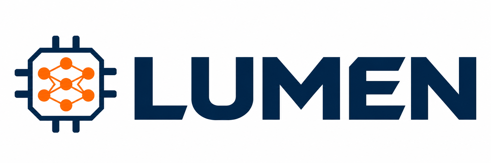

# LUMEN

  

LUMEN is a Lightweight Unified Mesh Engine for NPU.

The P0 native foundation is implemented: a CMake/Ninja/CTest host build with a
versioned C backend ABI and CPU/mock adapters. The engine, scheduler, KV
manager, model packer, and serving tools remain proposed designs. See
[Building and testing](docs/build.md).

## Design documentation

- [Architecture design](docs/init-draft/LUMEN-Architecture-Design.md)
- [Implementation roadmap](docs/init-draft/LUMEN-Implementation-Roadmap.md)
- [Phase design specifications from the MVP through industrial qualification](docs/architecture/README.md)
- [Implementation plans for each phase](docs/superpowers/plans/README.md)
- [Roadmap issues and phase tracking](docs/superpowers/issues/2026-11-25-roadmap-batch.md)
- [Proposed architecture decisions](docs/adr/README.md)
