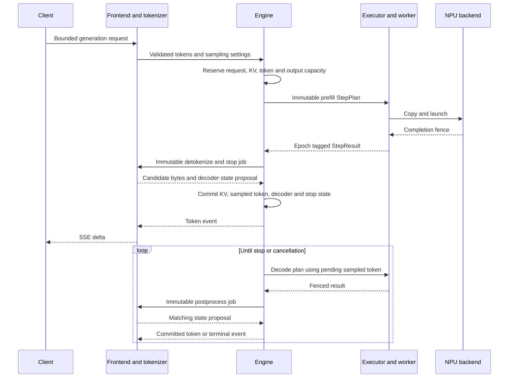

# P1 Native single NPU MVP

Document ID: LUMEN-P1-DESIGN | Version: 0.1 | Status: Proposed design

Date: 2026-11-25 | Release: R0.1 | Source: roadmap §4 and §14

## 1. Outcome and scope

Deliver a native process that loads one qualified dense decoder model on one NPU, streams correct generated text to multiple bounded clients, cancels safely, and reports measured resource and latency data. The mandatory packer and serving path contain no Python runtime dependency.

The MVP includes one model/tokenizer/template, one qualified precision, contiguous KV, greedy/temperature/top-k sampling, bounded FCFS/static or supported iteration batching, HTTP/SSE and a native interface. APC, native paged attention, distributed execution, speculative decoding, guided decoding, and full API parity are deferred. Adopt the [shared contracts](Shared-Runtime-Contracts.md) from the first runnable slice.

## 2. Entry gate from P0

| Dependency | Required evidence before P1 integration |
|---|---|
| LUMEN-001 build/ABI | CMake presets, CPU/mock adapters without vendor SDK, status/checked-math/TensorView foundations |
| LUMEN-002 device qualification | Named NPU/board/OS/driver/SDK/toolchain; actual launch and observed completion; alloc/copy/event/reset capability report |
| LUMEN-003 fixture/loader | Licensed immutable small-model fixture, independently generated tensors, native checked parser foundations |
| LUMEN-004 CPU Transformer | Operator/layer/logit comparisons and greedy generation with explicit tolerances |
| LUMEN-005 state/plan | Cursor, state transition, cancellation, generation and epoch tests |
| LUMEN-006 mock executor | Delayed/out-of-order/failing completions and reproducible event traces |

Resolve first model, tokenizer/template, precision, maximum context, and supported graph shapes from these results. If a required paged/custom operator is unavailable, P1 may use a qualified contiguous vendor path; record the P2/P3 limitation. A mock-only run cannot satisfy the single-NPU gate.

## 3. Components and interfaces

| Proposed area | Interface or responsibility |
|---|---|
| `tools/pack/`, `src/model/` | Native pack conversion, manifest validation, immutable model registry and TensorViews |
| `src/tokenizer/` | Exact tokenizer/template, bounded tokenization and immutable UTF-8/stop postprocess jobs; engine commits decoder state |
| `src/engine/` | Submit/cancel, sequence pool, token slabs, lifecycle and commit loop |
| `src/scheduler/` | Strict admission and FCFS/static batching policy over snapshots |
| `src/memory/` | Fixed contiguous KV store behind logical reserve/append/retire operations |
| `src/executor/`, `src/backend/` | Plan validation, one worker/device, CPU/mock/NPU adapters and completion fences |
| `src/frontend/` | Native API adapter, bounded HTTP/SSE reactor, health/readiness and quotas |
| `src/observability/`, `tools/bench/` | Request/step timestamps, memory categories, basic open-loop load harness |

The native API accepts a validated generation request and returns a request handle plus bounded token/terminal events. `cancel(handle)` is idempotent. Define ownership and callback/polling thread rules in the public C API; callbacks must never run inside an engine commit or block the engine. The reactor and native adapter use the same ingress and cancellation contracts.

The KV abstraction exposes logical capacity/reservation, a plan snapshot, commit of valid positions, and fenced retirement. P1 resolves these operations to a fixed contiguous region per admitted sequence; it does not expose device pointers to scheduling or claim native page reuse.

## 4. Pack, load, and startup

1. `lumen-pack` reads Safetensors and explicit model/tokenizer metadata. Check file sizes, header bounds, integer overflow, offsets, overlapping tensors, shapes, dtype, required tensor names, and model traits before allocation. Reject unsupported architecture or quantization.
2. Produce immutable packed tensors, tensor index, tokenizer/template assets, checksums, and a versioned manifest. Record source/license/digests, normalization/RoPE/GQA/weight-tying traits, precision, backend ABI/SDK requirements, layouts, graph buckets, alignment, and workspace bounds. Artifact filenames/manifest encoding remain implementation choices under [ADR 0005](../adr/0005-model-pack-and-precision.md).
3. Startup validates the pack and configuration, queries actual capabilities and usable memory, sizes all pools, allocates device weights/KV/scratch and host staging, then loads and prewarms allowed variants.
4. Perform a small qualified self-test before READY. Failure leaves readiness false with a reason code and releases only safely retired resources. Warmup measurements are separate from serving latency.
5. Pin one model generation for every request. Updates drain the process or replace a replica; no in-place mutation of weights/tokenizer/layout for active requests.

Development fixture generation may use an external framework; the independent reference and its version/seed are recorded. Ordinary host tests use small fixtures and require no board. Production signing is completed in P6; checksum validation and safe parsing begin here.

## 5. Request and execution flow

The engine drains completions and cancellations within finite budgets, retires leases, admits work, and dispatches only with executor capacity. The baseline has one plan executing per worker and one uncommitted step per sequence. It may batch multiple sequences when the chosen graph supports them. A static batch can queue later arrivals until a safe boundary; P2 adds general continuous batching.

Prefill may use one full prompt or finite supported chunks. Only the final chunk can sample. A decode plan consumes exactly the pending token and its logical position. The engine commits KV and sampled output separately. CPU sampling is an acceptable baseline: bounded logits staging must be included in memory and latency accounting. Top-k sorting/workspace is bounded by the model vocabulary and configured batch maximum.

Use the fixed tokenizer/detokenizer pool to compute proposed decoded bytes and stop state from immutable prior-state snapshots. Keep `inflight_step` set through this bounded postprocess stage; reserve its job/completion/state buffers before launch. The engine alone validates and installs the proposal together with KV/token/RNG state, and only then releases the next decode input. A delayed stop job cannot allow extra token generation or worker-side output. Cancellation suppresses its late proposal while retaining safe resource retirement. Include postprocess latency in step/commit measurements.

## 6. Admission, delivery, and limits

Strict admission reserves the worst-case request length and a fixed request/token/output budget. For P1 contiguous KV, charge the actual assigned region, including alignment and unused capacity. Reject/defer when the sum of existing commitments, workspace, staging, runtime reserve, and the candidate exceeds usable capacity. Driver-reserved memory is reported separately. Queue admission and active device admission are distinct, both bounded.

Proposed validation behavior:

- Check prompt plus maximum generated length, vocabulary IDs, sampling ranges, stop-string count/length, request body bytes, and tenant concurrency before activation.
- Normalize the prompt through the selected template/BOS rules. Reject a still-empty token sequence; never invent an unqualified model-specific input token.
- A valid request with `max_new_tokens=0` returns an empty terminal response without device execution. This is an author-proposed API choice to be confirmed during API review.
- An over-limit request receives an explicit error; no silent truncation. Unknown model/unsupported parameters are rejected with stable reason codes.
- An untrusted deployment requires authentication and tenant limits at the listener or an explicitly configured trusted gateway. Rate/body/time limits apply before expensive tokenization.

Use a fixed bounded output queue per request. Reserve worst-case token-event storage using the tokenizer's maximum decoded token size plus bounded stop/UTF-8 suffix storage. A client without output credits is not scheduled. If credits fail to recover by a configured timeout, cancel and drain. Do not hold a device lease while waiting on a socket.

Incremental decoding withholds undecidable stop-string/UTF-8 suffixes. Never emit matched stop text. Specify tie-breaking and EOS precedence, finish reasons, whether special tokens are returned, and whether the terminal sampled EOS counts toward usage. The proposed usage rule counts every committed sampled token, including a terminal EOS, separately from visible text bytes.

## 7. API and service lifecycle

Proposed MVP endpoints are `/v1/completions`, `/v1/chat/completions` for the qualified template, `/v1/models`, `/healthz`, `/readyz`, and `/metrics`. Document the exact supported request/response fields and error schema before exposing them; model selection is restricted to the loaded generation. Support streamed and bounded nonstreamed delivery through the same engine.

Before streaming, return an HTTP error for invalid input, overload (429/503), or startup failure. Once streaming begins, send a documented terminal error event when possible, then close; HTTP status can no longer be changed. SSE deltas carry request identity and monotonically increasing event/output offsets; send one normal finish event and stream terminator on success. A disconnect triggers cancellation. Client retries are new requests in P1; no automatic midstream resume is promised.

Lifecycle is STARTING → READY → DRAINING → stopped, with DEGRADED/FAILED for device errors. Readiness requires a loaded and prewarmed model, usable backend, and validated limits. Shutdown rejects new work, drains within a configured deadline, cancels remaining requests, then fences or tears down device work before freeing pools. Signal handlers only request shutdown; they do not call the vendor runtime.

## 8. Failure and recovery

| Failure | Required behavior |
|---|---|
| Admission or pre-submit queue failure | Roll back reservations; explicit retryable rejection |
| Invalid plan | Reject before launch; classify internal/validation error; no state commit |
| Cancel during execution | Stop future scheduling; suppress late output; retain leases until fence |
| Partial launch or device timeout | Fence epoch; quarantine affected resources; fail requests; qualified reset/teardown |
| Malformed result or stale identity | Reject commit; preserve safe resource retirement; emit diagnostics |
| Slow client/disconnect | Bounded pause then cancel; no device buffer held for network delivery |
| Process restart | Requests terminate; no implicit continuation or replay of emitted tokens |

Recovery restores readiness only after device/context and model self-tests pass. The MVP may fail affected requests rather than attempt uncertain transparent recomputation.

## 9. Verification and exit gate

| Roadmap work | Acceptance artifact |
|---|---|
| P1 step 1 / LUMEN-003 | Native parser negative tests, reproducible pack, immutable model/fixture/license manifest |
| P1 step 2 | Tokenizer/template parity, UTF-8 and cross-token stop fixtures, delayed/stale postprocess proposals, no next step before stop evaluation, seeded sampler checks |
| P1 step 3 / LUMEN-007 | First-layer and full-model logits vs CPU; supported precision tolerances; greedy non-ambiguous parity |
| P1 steps 4–5 | State/cursor/epoch tests; cancel before/during launch; delayed/duplicate completions; no cross-request leakage |
| P1 step 6 / LUMEN-008 | HTTP and native end-to-end generation; overload, error-after-stream, disconnect and slow-consumer tests |
| P1 step 7 | ARM64/x86-64 host builds where available, target cross-build, clean startup/shutdown and failed warmup tests |
| LUMEN-009 foundation | Fixed-store ownership/generation/lease tests and logical allocator interface for P2 |
| LUMEN-010 | Reproducible single-request/concurrency baseline with raw timestamps and memory categories |

Run at least 1,000 mixed requests and a 2-hour stress test within the qualified envelope. Require no crash, invalid sequence/storage references, or monotonic LUMEN-owned allocation growth after warmup. Exercise EOS, length, cancel, invalid inputs, and repeated startup/shutdown. Set numeric tolerances before comparing results.

The roadmap's initial experiment envelope—4 active sequences, 16 queued, 2K context, 128–512 prompt and 64–256 output tokens—is a candidate workload, not a default or achieved capacity. Record actual hardware/model/precision, offered/admitted/completed/rejected rates, TTFT/ITL/TPOT, p99 host dispatch cost, memory high water, and power where measurable. P1 exits only after a real NPU streams correct output and cancellation is reproduced from a script.

## 10. Deliverables and remaining decisions

Deliver native build/dependency configuration, CPU/mock/NPU adapters, `lumend`, `lumen-pack`, a basic `lumen-bench`, minimal `lumen-inspect` capability/manifest reporting, native API headers, model fixture, config examples, integration scripts, and the R0.1 evidence report. Full replay tooling and paged allocators arrive in P2.

Before implementation planning, settle the P0 target/model/precision evidence, tokenizer/template library and license, HTTP/TLS dependencies, supported graph envelope, and exact C/API schemas. Dependency selection and descriptor encoding may be settled by the builder after footprint/license review; hardware feasibility and product limits require explicit qualification. See [ADRs 0001–0005](../adr/README.md).
