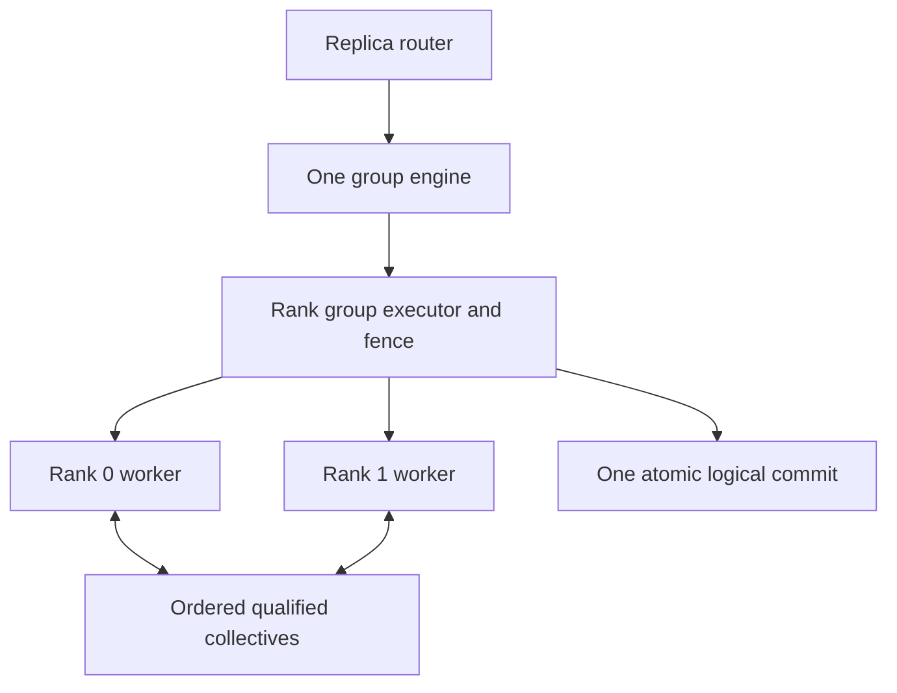

# P4 Replica mesh and local TP

Document ID: LUMEN-P4-DESIGN | Version: 0.1 | Status: Proposed design

Date: 2026-11-25 | Release: R0.5 | Source: roadmap §7

## 1. Outcome and entry gate

Scale the accepted [P3 engine](P3-NPU-Optimization-and-Prefix-Reuse.md) through independent replicas first. Add local tensor parallelism (TP) only when qualified hardware and measured memory/performance benefit justify it. The two tracks have independent acceptance reports; a replica release does not imply TP support.

Entry requires an accepted single-node envelope, authenticated bounded service endpoints, immutable model identities, load/capacity metrics, and request/output-offset semantics. TP additionally needs a fixed local topology, vendor/host transport qualification, rank-sharded artifacts, and small-model reference parity. WAN/inter-site TP is outside the baseline.

## 2. Replica mesh components

| Component | Contract |
|---|---|
| Static registry | Bounded configured nodes, addresses, identities and supported models; dynamic discovery can follow |
| Node advert | Authenticated soft state with TTL, model/tokenizer/layout digests, backend/SDK, roles, queue delay, rates, KV allocated/reserved/headroom, health, thermal and network pressure |
| Router | Bounded ingress and per-node queues; selects node and owns client delivery; no token-step scheduling |
| Submission ledger | Bounded idempotency-key binding, request fingerprint, selected node/attempt, state, expiry and terminal metadata |
| Local engine | Sole owner of its sequence, logical KV, deadlines, cancellation and output offsets |

Independent nodes keep separate KV pools; prefix hints are locality estimates, not transferable ownership or guaranteed hits. Reuse remains subject to the target engine's exact identity and admission transaction. Start with several independent processes on one host before separate boards.

## 3. Routing and admission

Filter nodes by READY status, fresh advert, model generation, required precision/features and network/tenant policy. Estimate completion from queue wait, qualified service rate, request length, locality/prefix hint, and transfer/thermal pressure. Use stable tie-breaking and hysteresis to avoid every router moving to the same freshly idle node. Exact weights are tunable policy, recorded with benchmark evidence.

The chosen node performs final local admission; stale headroom cannot authorize allocation. A confirmed overload rejection permits reroute within a bounded attempt/time budget. Advert expiry excludes a node for new work. Router overload returns explicit retryable rejection rather than creating an unbounded control-plane queue.

Affinitize active sessions to their current node. Without P5 remote ownership, follow-up requests can recompute elsewhere but cannot claim continuation from an unknown live KV state. Apply per-tenant queue and concurrency limits at both router and serving node to prevent bypass.

## 4. Idempotency, streaming, and retry boundary

Bind an idempotency key to a canonical request fingerprint, model generation, destination and attempt. A duplicate with the same fingerprint reconciles the existing submission; a conflicting fingerprint is rejected. Bound ledger entries and retention. If capacity is exhausted, reject new idempotent submissions instead of silently dropping deduplication state. Expiry semantics and restart behavior are documented; durable cross-router deduplication is not implied by an in-memory ledger.

The baseline permits one router-owned delivery stream per request. After the first client-visible output, node failure terminates the stream with a reason; there is no automatic resume or replay. Before output, retry automatically only after a confirmed nonacceptance or terminal cancellation, or under a separately qualified attempt-fencing protocol. Lost acceptance acknowledgement is an uncertain submission: query the original node by key; do not blindly create an independent request elsewhere. If reconciliation fails, terminate the affected request within its timeout. Route new requests to healthy nodes.

This conservative rule prevents hidden duplicate execution/output while leaving more aggressive pre-output retry as an explicit extension. If that extension is implemented, a monotonically fenced attempt must govern all output forwarding and stale attempt streams must be discarded. It must not be confused with P5 session ownership transfer.

Router disconnect propagates cancel. Bound network buffers and end-to-end output credits; a slow client cannot make the router accumulate arbitrary node output. Propagate request identity, selected node/attempt, model digest, terminal reason, and output offset in diagnostics without logging prompt text.

## 5. Node lifecycle and rollout

Nodes advertise STARTING/READY/DEGRADED/DRAINING/FAILED with epoch and freshness. Drain removes new assignments, preserves existing local ownership until completion/cancel, then unloads. Model rollout registers a new digest separately, validates readiness, shifts new traffic, and drains the old generation. Rollback changes placement for new requests without changing active model semantics.

Failure detection distinguishes a stale advert from a proved process failure. Both can exclude new work; neither authorizes remote use of live local pages. Router loss may terminate client streams; node-side request deadlines/heartbeat policy bound orphaned work. Control-plane metrics are hints with bounded TTL and must not block local completion retirement.

## 6. Local TP group architecture

Offline packing emits explicit rank descriptors for embeddings/attention/MLP/LM-head partitioning, tensor offsets, replicated tensors, layer/head ownership, and collective points. GQA KV heads must divide the chosen degree or use a qualified replication map. A rank-local layout maps common logical pages to physical slots; capacity is constrained by the most loaded rank. Never infer sharding from tensor shape alone.

The logical engine transaction reserves every rank's required pages/scratch and builds one epoch-tagged group plan. Fixed membership, step ordering, and collective sequence IDs prevent mismatched operations. Each rank reports compute and collective fences. Commit only when every required rank completes the same iteration; failure on any rank invalidates the group iteration and affected sessions.

Use vendor device collectives where supported, or measured bounded host staging. Capability reports must identify actual queue ordering, peer access, alignment, timeout/reset and overlap. Do not assume CUDA/NCCL behavior. A missing collective may make TP unsupported rather than silently selecting a slower unqualified path.

## 7. TP faults and cost gate

On rank loss or collective timeout, stop group admission and dispatch, advance/fence group epoch, fail or restore from a verified checkpoint, and quarantine touched buffers until all ranks are safely fenced/reset. A timeout alone does not free collective buffers. Recreate membership only after teardown/self-tests; do not hot-replace a rank in an active request. Unrelated replicas continue.

Measure per-layer collective startup/jitter, effective bytes, host CPU and overlap under real contention. A same-model TP configuration must improve a declared SLO/capacity outcome; a slower configuration is acceptable for a model that otherwise cannot fit if it still meets its declared envelope. Ring traffic formulas are planning bounds, not actual vendor throughput. No local-link result qualifies WAN TP.

## 8. Verification and exit gate

| Track | Required evidence |
|---|---|
| P4A registry/router | Auth, stale adverts, overload, skew, route hysteresis, tenant quotas, multiple local instances then independent devices |
| P4A lifecycle | Node drain/crash, router restart, duplicate key/conflicting payload, lost acceptance ACK, slow clients, no duplicate client-visible offsets |
| P4A scale | Matched one/two replica open-loop tests with router/network overhead, offered/admitted/rejected demand and tail latency |
| P4B sharding | Small-model single-rank vs TP logits/tokens, explicit supported rank/head/layout matrix and per-rank memory accounting |
| P4B execution | Rank loss at copy/launch/collective/commit stages, delayed/stale results, atomic reservation and group commit, bounded recovery |
| P4B value | Larger-model feasibility or measured same-model latency/goodput benefit with actual topology and SDK |

The roadmap's suggested ≥1.7× aggregate SLO goodput with two equal independent replicas is provisional and assumes sufficient router/network capacity. Report skew, routing cost, failure handling, and workload compatibility. TP is enabled only for its qualified model/rank/topology combinations. Replica success cannot waive TP correctness or performance gates.

## 9. Deliverables and open decisions

Deliver static registry/config, authenticated node adverts, bounded router and submission reconciliation, rollout/drain runbooks, routing metrics and R0.5 replica report. Conditional TP adds sharded packs, collective adapter, group executor/fault tests and separate topology report. Extend `lumen-inspect` to report compatibility, ranks and local topology.

Before enabling TP, settle interconnect/collective access, rank degree, sharding/replication, driver recovery and justified SLO. Before aggressive retry or multiple routers, select durable submission/attempt authority and failure semantics. Exact routing weights and registry encoding are builder choices, measured within these boundaries. See [ADR 0006](../adr/0006-distributed-execution-authority.md).
