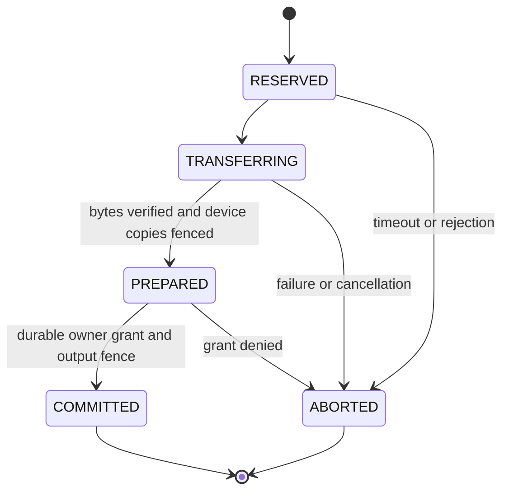

# P5 Advanced distribution

Document ID: LUMEN-P5-DESIGN | Version: 0.1 | Status: Proposed design

Date: 2026-11-25 | Release: R0.7 optional | Source: roadmap §8

## 1. Outcome and feature entry gates

Enable advanced distribution only for a workload whose measured capacity, latency, energy, or goodput benefit exceeds its transfer and coordination cost. P5 is optional for R1.0. Entry requires the actual single-NPU demo, accepted [P4](P4-Replica-Mesh-and-Local-TP.md) foundations, and the [shared contracts](Shared-Runtime-Contracts.md). Interface exploration may happen earlier; distributed KV implementation does not precede the demo.

| Feature | Additional entry evidence | Default |
|---|---|---|
| Pipeline parallelism (PP) | Model cannot fit locally or TP is too costly; acceptable pipeline latency and topology | Disabled |
| Remote KV handoff | Compatible layouts, useful reuse/restore, adequate measured bandwidth, durable authority and output checkpoint semantics | Disabled |
| Prefill/decode separation | Sustained asymmetric workload or complementary resources; positive coupled-admission benefit | Disabled |
| Global prefix hints | Repeated prefixes across nodes justify bounded metadata and privacy cost | Disabled |
| Speculative decoding | Qualified draft/target pair and net benefit after verification/rollback | Disabled |
| MoE/EP, MLA, multimodal | Explicit product requirement and separate model/layout capability design | Outside baseline |

Each selected feature receives its own supported matrix, fault report, numerical evidence, benefit comparison, and rollback switch. Qualification of one does not enable the others.

## 2. Transfer and checkpoint records

Remote KV is a transfer of an immutable committed snapshot followed, when requested, by an authoritative execution handoff. It is never a shared mutable page cache.

| Record | Required contents |
|---|---|
| Compatibility manifest | Protocol/schema version, model/tokenizer/template/adapter digests, attention/RoPE traits, precision, exact KV layout, page tokens, shard map and rank group |
| Source snapshot | Session identity, ownership epoch, committed KV cursor and valid lengths, token slab/required history, pending sampled token, generated count, sampling/RNG state, stop/detokenizer suffix state, output offset |
| Transfer descriptor | Transfer ID, source/destination identities and slot generations, destination reservation epoch, chunk byte ranges/checksums, total bounded bytes and deadline |
| Authority record | Current owner/epoch, frozen source checkpoint, prepared target/transfer digest, grant/revocation status and durable transition version |
| Delivery checkpoint | Router/session identity, source committed output-event watermark K, matching router forwarded watermark K, decoder suffix/terminal state, output-attempt fence and drain acknowledgement |

Checksum protects integrity; authenticated encrypted transport protects identity and content. Treat token history and KV as sensitive. Default tenant isolation extends to hints, transfer storage, retention, and cleanup. No conversion across incompatible layout/precision/shards is enabled unless separately implemented and numerically qualified.

## 3. Handoff state machine and authority



1. The target reserves pages, metadata, output and transfer credits under a destination epoch; it returns bounded descriptors and a transfer ID. Reservation alone grants no execution right.
2. The source reaches a fully committed device/postprocess step boundary, stops scheduling the session, fences its in-flight work, freezes token/RNG/detokenizer state and committed output-event watermark K, and pins immutable KV. Drain every ordinary queued output event through K to the router under the delivery barrier below. Mutable valid tails are copied from a frozen exclusive snapshot; destination tails stay private.
3. Transfer chunked manifests/payloads with bounded credits. Target validates identity, checked sizes/offsets, checksums and valid lengths. Duplicate chunks are idempotent only for the same digest/range.
4. Target fences all device writes and reports PREPARED with the exact checkpoint digest. Prepared pages remain invisible to scheduling/cache lookup.
5. The authority verifies that source execution is revoked/fenced and the router has acknowledged forwarding every event through K. Both target PREPARED and output-drain acknowledgement are required. It durably compare-and-swaps owner epoch to the prepared target and issues the grant. The target executes only after validating this grant; the router accepts output only from that granted attempt/epoch.
6. Target atomically installs the logical mapping and resumes from the pending input token. Source retires leases after durable acknowledgement or an authority-confirmed abort/cleanup decision. Transfers do not reset sampling counters or regenerate output offsets.

The conservative baseline requires a source freeze/fence acknowledgement before granting a new owner. If source or authority is unreachable, fail closed; a timeout is not proof that old execution stopped. Forced failover using leases would require a separate qualified lease/clock/device-enforcement protocol. A durable store or consensus-backed service must survive coordinator restart and preserve monotonic grants; a volatile simulator coordinator is insufficient for production.

Duplicate preparation/grant/acknowledgement messages reconcile by transfer ID, digest and epoch. Once the durable grant exists, a lost ACK does not permit source resumption or target rollback to an earlier owner. Query the authoritative record. Before grant, abort reclaims target reservations only after DMA fences; the source may resume only after authority confirms that no grant occurred. Expired source/target sessions retain uncertain buffers until safe teardown.

## 4. Output continuity and cancellation

The baseline supports handoff behind one surviving router stream and requires drain-before-grant. After source execution freezes at committed event watermark K, forward all queued ordinary deltas through K and obtain the router's matching drain acknowledgement. Then fence the old delivery attempt. The target starts newly committed output events at K+1. No ordinary committed-but-unforwarded event is omitted or reconstructed from token history; this baseline does not transfer such an event queue. For example, if the engine committed events 1–10 and the router forwarded only 1–5, grant waits until events 6–10 have also been forwarded.

The undecidable stop/UTF-8 suffix has not yet become ordinary output and moves with decoder state. Keep event offsets, sampled-token counts and byte positions distinct. A slow client that prevents the drain before the handoff deadline prevents the grant; resume source only after authority confirms no grant, or terminate under the normal output-timeout policy. Never replay an event merely because a transfer acknowledgement was lost.

If delivery state is ambiguous, terminate with a clear error. Cross-router/client-reconnect resume requires explicit persisted offset/acknowledgement semantics and separate qualification; an HTTP reconnect alone is not a checkpoint. The target's committed KV cursor may trail the last sampled token, so transfer the pending token and RNG state explicitly.

Cancellation during transfer prevents execution grant when possible. If grant raced with cancellation, the authority resolves the current owner and routes an epoch-tagged cancel there. Source and target cleanup remain fenced independently. Credits and request deadlines remain bounded while ownership is unresolved.

## 5. Data plane and benefit model

Use separate bounded transfer queues/arenas, per-tenant byte limits, chunk checksums, retry caps, and in-flight-byte credits. Lease source pages through the last read and target pages through the last write. DMA/compute overlap is a negotiated capability; reflect serialized copies in the scheduler when unavailable. Transfer traffic must not exhaust decode scratch, output credits, or network service for existing interactive traffic.

```text
T_transfer = setup + bytes / measured_effective_bandwidth
             + pack + source_copy + target_copy + verify + admission_wait
benefit = alternative_queue_or_recompute_cost - T_transfer - coordination_cost
```

Measure complete wall time and avoid double-counting costs already included in effective bandwidth. The roadmap's 1 GiB/50 Gb/s ≈172 ms example is an ideal payload bound before copies, encryption, contention and jitter. Compare actual short/long prompts, burst traffic, affinity loss, reused prefixes, degraded links and deadline margin. Migrate only above a conservative positive-benefit threshold with hysteresis; capacity necessity is a separately stated justification.

## 6. Pipeline parallel execution

Pack explicit layer-stage descriptors and immutable model generation. A fixed PP group owns one logical engine authority, rank/stage epochs, bounded activation buffers and ordered microbatch identifiers. A stage forwards activations only after its producing fence; the consumer validates shape/dtype/step and records completion. Each stage owns the KV for its layers under the common logical sequence cursor.

Microbatch across different sequences to fill stages. One outer group `StepPlan` contains the finite set of microbatches and their stage dependencies; each worker accepts that plan once and pipelines only its internal stage work. Preserve one uncommitted step per sequence. Group commit waits for every microbatch's required stage, transport, sampling and detokenizer/stop completion, then atomically commits all selected items. Any failed microbatch fails the outer iteration. Backpressure is credit-based at every boundary; a slow stage cannot create an unbounded activation queue.

Overlapping independent outer plans, committing microbatches separately, or issuing multiple steps of the same sequence requires a new versioned execution/commit protocol and is deferred. Measure the latency cost of waiting for the full outer plan before emission when deciding whether baseline PP is worthwhile.

Stage failure fences the entire affected model-parallel group. Keep unrelated replicas live. Repartition only after draining active sessions. Measure bubbles, balance, activation bytes, p99 token latency and recovery; PP is justified by capacity feasibility or a declared net workload benefit.

## 7. Prefill/decode separation and prefix hints

The router selects a prefill role only after reserving a compatible decode destination or a bounded handoff commitment. Link prefill admission, target KV capacity, transfer credits, and session deadline in one coordinator transaction. If no destination can commit, defer/reject or use a qualified colocated fallback; do not finish arbitrary prefills into an unbounded waiting-KV queue.

After final prefill, transfer the committed KV plus first sampled/pending token and its exact delivery state. The source must not independently stream tokens after ownership moves. Adapt placement using measured prefill, transfer, decode queue and thermal cost. Abort/timeout unwinds reservations without violating source/target leases.

Global hints expose bounded tenant-scoped prefix digests, compatible model/layout, approximate reusable length, node and TTL. They are advisory and may be stale. The receiving engine still performs exact local lookup/pinning; hints confer neither references nor ownership and carry no mutable remote page pointers.

## 8. Optional speculation boundary

Treat a draft/verify cycle as one uncommitted execution transaction with private tentative KV, a bounded draft length, and separate draft/target RNG domains. Only target-validated output advances the committed output/RNG/KV cursors; rejected suffix pages and positions retire behind fences. Stop/EOS and final sampled-token accounting apply to the accepted prefix.

Greedy verification accepts only the target's matching token prefix. A stochastic implementation must specify and test an exact acceptance/rejection algorithm (including the target and draft distributions after identical request filters), rather than treating matching sampled tokens as distributional equivalence. Freeze that algorithm and its rollback cursor equations in an additional accepted ADR before enabling the mode. This specification reserves the integration boundary; it does not qualify a draft model or algorithm.

## 9. Verification and exit gate

| Feature | Mandatory acceptance evidence |
|---|---|
| Remote transfer | Duplicate/out-of-order chunks, corruption, stale slot generations, partial DMA, lost ACKs, source/target failure, cancellation and reservation cleanup |
| Authority | Network partitions, coordinator crash/restart, stale grants, concurrent attempts, delayed source revocation; no two valid owners and fail-closed uncertainty |
| Continuation | Compatible target tokens within qualified numeric rules; exact pending-token/RNG/stop/offset state; queued-output drain barrier, slow-client timeout and no lost/duplicate forwarded events |
| PP | Single-stage reference parity, stage faults, activation credits, group atomic commit and bounded recovery |
| Phase separation | Coupled admission/credits, decode saturation, failed handoff/fallback, and positive matched end-to-end SLO benefit |
| Prefix hints | TTL/model/tenant isolation, stale hints, bounded directory size, no bypass of exact pinning |
| Speculation if selected | Accepted algorithm, independent semantic/distribution checks, rejection/rollback faults and positive verification-inclusive benefit |

Each PP/P-D/remote-KV mode must demonstrate workload-specific capacity feasibility, lower p99 latency, lower energy, or higher SLO goodput with no hidden regression outside its declared envelope. Compare against local recomputation, queueing and replicas. Disable every unqualified path. Passing P5 is not required for a P3/P4-based R1.0.

## 10. Deliverables and blocking decisions

For selected features, deliver versioned protocol/manifest schemas, authority adapter and operational failure model, transfer/activation credit pools, role-aware router, fault/replay corpus, security/retention controls, deployment examples and R0.7 evidence. Extend inspect/replay tooling for ownership/grant and transfer timelines.

Production remote ownership is blocked until the durable authority implementation, source fencing method, output checkpoint semantics, target layout compatibility and measured network envelope are selected and tested. PP stage placement and P-D roles need workload evidence. MoE/EP, MLA and multimodal remain separate requested capability designs. See [ADR 0006](../adr/0006-distributed-execution-authority.md).
