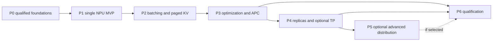

# LUMEN phase design specifications

Document ID: LUMEN-DESIGN-INDEX | Version: 0.1 | Status: Proposed design

Date: 2026-11-25

These specifications turn the [implementation roadmap](../init-draft/LUMEN-Implementation-Roadmap.md) into component contracts, execution flows, failure behavior, and acceptance evidence for P1 through P6, beginning with the native single-NPU MVP. The [architecture design](../init-draft/LUMEN-Architecture-Design.md) remains the system-level source. P0 is an entry dependency rather than a new implementation phase in this set.

The checkout contains design documents only. Interfaces, configuration fields, artifact schemas, and module paths below describe proposed implementation work. Numeric settings and performance thresholds remain provisional until qualified on a named model, device, SDK, and workload.

## Specification map

Read the shared contracts first, then the phase being planned and its prerequisites.

The [phase implementation plans](../superpowers/plans/README.md) translate these specifications into ordered tasks, exact interface/file contracts, test cases, and release evidence. They remain proposed and unexecuted.

| Specification | Release and scope | Entry dependency |
|---|---|---|
| [Shared runtime contracts](Shared-Runtime-Contracts.md) | Ownership, token cursors, ABI, resources, completion, versioning | P0 contracts and CPU/mock foundations |
| [P1 native single-NPU MVP](P1-Native-Single-NPU-MVP.md) | R0.1: native loading, generation, bounded HTTP/SSE | P0 CPU oracle, model fixture, backend feasibility |
| [P2 continuous batching and paged KV](P2-Continuous-Batching-and-Paged-KV.md) | R0.2: transactional pages, iteration scheduling, replay | Accepted P1 baseline |
| [P3 NPU optimization and prefix reuse](P3-NPU-Optimization-and-Prefix-Reuse.md) | R0.3: qualified kernels, APC, precision, adaptive policy | Accepted P2 safety and goodput evidence |
| [P4 replica mesh and local TP](P4-Replica-Mesh-and-Local-TP.md) | R0.5: routing first, conditional local model parallelism | Accepted P3; topology qualification for TP |
| [P5 advanced distribution](P5-Advanced-Distribution.md) | R0.7: optional PP, remote KV, phase separation | Single-NPU demo and accepted P4; per-feature business and hardware gate |
| [P6 industrial qualification](P6-Industrial-Qualification.md) | R1.0: product acceptance of the supported feature set | Accepted P3/P4 scope; P5 only if included |

Security, observability, CI, and failure testing start in P0/P1; P6 completes their release qualification. A production single-node or replica deployment can reach R1.0 without remote KV, PP, or prefill/decode separation.

## Design choices and approval boundaries

The roadmap already establishes C++20, a C-compatible backend ABI, a single logical engine writer, immutable plans, bounded resources, CPU/mock support, and replica-first distribution. These specifications preserve those constraints.

The author proposes a common contract document, explicit queue acceptance semantics, transactional output credits, a capability-based feature registry, and machine-readable release evidence. These refinements are design proposals for review. Exact field layouts, dependency libraries, graph buckets, and target-specific thresholds remain implementation decisions subject to the contracts and gates.

The [proposed ADR register](../adr/README.md) records the decisions that must be accepted before their interfaces or policies are frozen. An ADR in Proposed status is not an approved hardware choice or implemented API. In particular, the target NPU, SDK, first model/tokenizer, shipping precision, tenant policy, SLO profile, and network envelope require evidence and product agreement.

## How to use the specifications

1. Establish P0 evidence: target qualification, independent CPU fixtures, native loader foundations, C ABI lifetime rules, immutable plans, and mock asynchronous execution.
2. Plan P1 as the first complete serving slice. Add later phases only after their entry gates pass.
3. Map implementation changes to a requirement and acceptance artifact in the phase tables. Run CPU/mock checks without a vendor SDK and board checks on qualified hardware.
4. Record supported model/backend/precision/layout/topology combinations explicitly. Unsupported combinations stay disabled.
5. Publish a release report with commit, build, model digest, workload, measurements, failures, rejected demand, and raw evidence. Do not turn a suggested target into a result.

## Source traceability

| Roadmap section | Design coverage |
|---|---|
| §3 P0 and §14 LUMEN-001…006 | P1 entry gate and shared contracts; prerequisites remain P0 work |
| §4 P1 and §14 LUMEN-007…010 | P1 serving path; P2 expands the allocator and benchmark coverage |
| §5 P2.1…P2.6 | P2 work-package acceptance table |
| §6 P3.1…P3.3 | P3 kernel, cache, and scheduler qualification |
| §7 P4A/P4B | P4 independent replica and TP tracks |
| §8 P5 | P5 per-feature entry and benefit gates |
| §9 P6 | P6 release acceptance matrix |
| §10 repository/build, §11 benchmarks, §12 discipline, §13 risks | Shared contracts and each phase's delivery, evidence, and open-decision sections |
