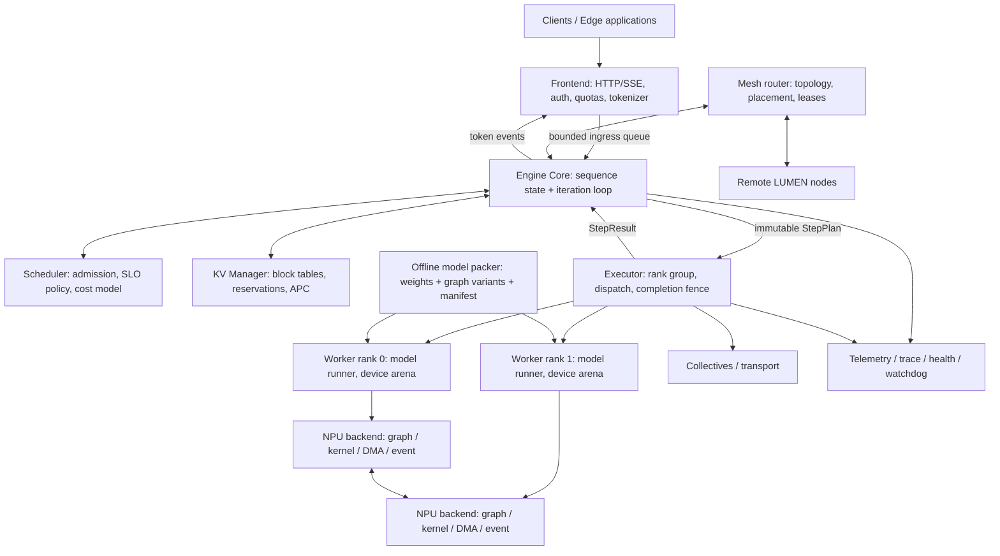
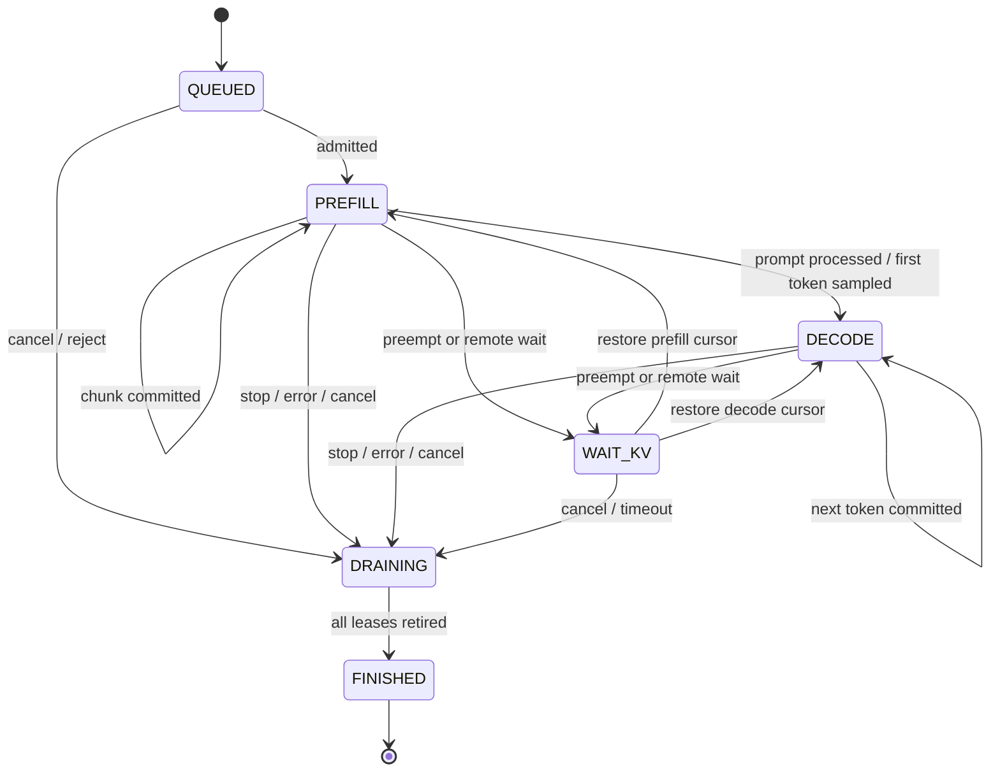

# LUMEN — Architecture Design Specification

**Lightweight Unified Mesh Engine for NPU**  
Document ID: LUMEN-ARCH-001 | Version: 0.1 | Status: Proposed design  
Date: 2026-11-25 | Companion: [Implementation Roadmap](LUMEN-Implementation-Roadmap.md)

## Executive summary

LUMEN is a native C/C++ LLM serving engine for resource-constrained, network-edge systems equipped with NPUs. It combines iteration-level continuous batching, explicitly managed paged KV memory, hardware-specialized execution, and topology-aware distributed serving. Unlike a general-purpose training framework, LUMEN treats model execution as a finite set of preplanned, bounded-resource inference programs. Its runtime has no Python interpreter, Python GIL, garbage collector, or mandatory general-purpose tensor framework.

The primary architectural decision is to separate **serving semantics** (requests, scheduling, logical KV ownership and SLOs) from **device execution** (physical layout, command queues, kernels and collectives). A single-writer Engine Core owns sequence state and allocation decisions; independent device workers execute immutable plans asynchronously. A separate Mesh layer routes requests and coordinates explicitly supported distributed groups. A small offline model packer produces validated NPU-ready artifacts; a CPU reference backend makes algorithms testable without the target hardware.

Success is measured by SLO-constrained goodput, p99 inter-token latency, bounded resource consumption, energy per generated token, correctness and recovery—not just peak tokens per second. Native code removes some sources of overhead but does not guarantee faster kernels, hard real-time behavior or superior throughput to vLLM. Those benefits must be demonstrated on the same hardware, model and workload.

## 1. Scope, assumptions and design principles

| Topic | Proposed baseline |
|---|---|
| Deployment | Embedded Linux, ARM64 or x86-64 host, one or more NPU devices; isolated process or container |
| Language | C++20 host runtime, C-compatible backend ABI; C/C++ or vendor-native kernel toolchain; no Python runtime dependency |
| Models | Decoder-only dense Transformer, Llama-like GQA/MHA with RMSNorm, RoPE and SwiGLU first; other families added via explicit capabilities |
| Serving | Text generation, streaming, OpenAI-compatible subset; greedy and stochastic sampling |
| Memory | Device DDR/HBM or unified memory, on-chip SRAM, optional pinned host staging, optional remote KV tier |
| Distribution | Standalone, request-level replication, local TP, then topology-qualified PP and remote KV handoff |
| NPU | Vendor unspecified; backend support for asynchronous queues, memory, graph or kernel launch must be verified |
| Latency | Predictable soft real-time under a declared workload envelope; no hard deadline guarantee on an unqualified OS/driver |
| Non-goals initially | Training, arbitrary PyTorch graph execution, multimodal models, MoE, arbitrary heterogeneous TP, full API parity |

Principles:

1. **Bound resources before admitting work.** Every request, token slab, queue, workspace, transfer and device page is budgeted. No unbounded queues or emergency allocations in steady state.
2. **Single authority, explicit ownership.** Only the engine thread commits request state and logical KV mappings. Workers own device buffers and report completion, not scheduling decisions.
3. **NPU-first, not CUDA-first.** Shape bucketing, static graphs, tiled layout, DMA alignment, SRAM banking and device-specific quantization are first-class constraints. GPU-style kernels are not presumed portable.
4. **Separate mechanism from policy.** A pluggable scheduling policy selects work using cost and capacity snapshots; the allocator and executor enforce correctness regardless of policy.
5. **Deterministic decisions, asynchronous execution.** Stable tie-breaking, fixed budgets and event ordering support replay; numerical reproducibility is a separately qualified mode.
6. **Locality first.** Use local memory and local replicas whenever possible. Communicate activations or KV only when a topology-aware cost model justifies it.
7. **Evidence-driven optimization.** A CPU oracle, simulator, replayable traces and device microbenchmarks precede complex distributed optimizations.

### 1.1 What to borrow and what to redesign

Iteration scheduling is inspired by Orca [1]; paged KV allocation by vLLM [2, 3]; chunked prefill by Sarathi-Serve [4]; tiled online attention by FlashAttention [5]; phase separation by DistServe [6]. llama.cpp [7] is a useful native-runtime and portability reference. LUMEN should borrow these mechanisms, not reproduce the Python process topology or assume that GPU memory layouts, graphs, kernel shapes, and interconnects transfer directly to NPUs. The architecture, APIs and targets below are proposals, not a claim of measured implementation results.

## 2. System architecture



The five data-path layers are Frontend, Engine/Scheduler, KV Management, Execution, and Backend/Collectives. Mesh and Operations are cross-cutting services; model preparation is outside the serving path. All device-dependent objects remain within the backend and worker boundary.

### 2.1 Deployment modes and thread topology

| Mode | Processes and ownership | Intended use |
|---|---|---|
| Embedded library | One process; engine thread, I/O reactor, tokenizer pool, one worker thread per device | Small appliances, lowest IPC overhead, trusted application |
| Standalone daemon | Supervisor plus one serving process; same internal threads | Default single-node deployment; process lifecycle managed by systemd/container |
| Isolated workers | Engine process + one worker process per device/rank | Driver fault containment, vendor context constraints; shared memory for plans/results |
| Edge mesh | Independent serving nodes + router/control service; rank groups where justified | Multi-site capacity and locality; no global token-by-token scheduler for replicas |

Each device worker binds to a CPU core or bounded CPU set according to profiling and driver constraints. The engine has a dedicated owner thread; reactor handles sockets; tokenizer and detokenizer use a small fixed pool. Communication completion polling can be separate where the backend requires it. Use `epoll` as the portable Linux baseline, optional `io_uring` after measuring support and benefit. C++20 coroutines may simplify I/O; they are not a requirement for the scheduler. SPSC rings connect single producer/consumer pairs; bounded MPSC queues aggregate ingress. Shared-memory IPC carries offsets, generations and fixed-size descriptors, never process-local pointers. Use release/acquire publication and a wakeup mechanism (eventfd/futex); optional short adaptive spinning trades power for latency. Queue-full handling is explicit.

Pinning, pre-faulting, memory locking, CPU isolation, IRQ affinity and scheduler policy are deployment options validated on the target Linux build; they are not blanket requirements. Avoid taking locks across driver calls and never rely on busy polling if it violates the edge power budget.

### 2.2 End-to-end request flow

1. Reactor authenticates, parses bounded request, checks quotas and sends text to tokenizer. Chat template and tokenization are pinned to the model version.
2. Engine receives token IDs and configuration; admission validates length, estimated work, active sequence limit, output credits and KV commitments.
3. KV manager finds the longest compatible full-block prefix and reserves pages; scheduler selects prompt chunks and decode tokens for the next iteration.
4. Engine publishes immutable `StepPlan` with batch ID, model generation, input tokens, positions, block table snapshots, slot mappings, per-sequence phase and sampling parameters. Executor stages metadata, launches device work and monitors events.
5. Workers execute embeddings, layers, logits and sampling. All rank completions and required collective operations are fenced before the result is accepted.
6. Engine validates completion epochs, commits computed token positions and sampled output, releases leases, publishes sealed prefix blocks and updates deadlines. Output queue emits token deltas to the streaming frontend.
7. On EOS, length limit, stop text, cancellation or error, engine enters terminal state, drains in-flight work and reclaims memory only after all leases retire.

## 3. Module decomposition and contracts

| Module / code area | Responsibility and key interfaces | Owner / critical constraints |
|---|---|---|
| `frontend/` | HTTP/SSE, admission envelope, cancel, readiness, streaming | Reactor; no blocking device access; bounded body/output |
| `tokenizer/` | Tokenizer, chat template, incremental decoding, stop handling | Fixed CPU pool; exact model parity; UTF-8-safe streaming |
| `engine/` | Sequence state, event loop, lifecycle, batch commit | Single writer, monotonic IDs and timestamps |
| `scheduler/` | Admission, continuous batching, deadlines, fairness, cost estimation | Pure policy over snapshot, stable tie-breakers |
| `memory/` | Host arenas, device pools, KV allocation, block tables, APC, swap | Engine owns logical map; workers own physical allocations |
| `executor/` | Rank group, immutable plan dispatch, completions, failure fence | No scheduler policy; epoch-tagged execution |
| `model/` | Model registry, layer runners, TensorViews, graph variants | Explicit model traits; no runtime graph interpretation requirement |
| `backend/` | Device ABI, memory, events, command streams, operator launch | Opaque handles, capability negotiation, vendor-specific implementation |
| `kernels/` | NPU GEMM, normalization, attention, RoPE, sampling, fusion | Layout-aware, precision-qualified, measured scratch bounds |
| `collective/` | TP/PP communication, rank group membership, ordered collectives | Bounded buffers, timeouts, topology-aware transport |
| `mesh/` | Discovery, routing, placement, health, remote KV transfer | Per-node scheduling authority; fenced sessions and leases |
| `modelpack/` | Safetensors/GGUF import, conversion, sharding, validation | Offline C/C++ tool; reproducible signed/versioned artifacts |
| `observability/` | Metrics, structured events, traces, replay, watchdog | Nonblocking, bounded, redacted; dropped telemetry counter |
| `tests/`, `bench/`, `sim/` | CPU oracle, differential tests, fuzz, synthetic/replay workloads | Independent checks; reproducible configuration |

### 3.1 Request state machine and token accounting



Separate `state` from `inflight_step` and the terminal reason (`EOS`, `STOP`, `LENGTH`, `CANCELLED`, `DEADLINE`, `DEVICE_ERROR`, etc.). A sequence must have at most one uncommitted step in the baseline. Its token buffer stores prompt and generated token IDs; `kv_committed_tokens` counts tokens whose K/V has actually been written. The last sampled output token is normally pending input for the next decode step and **does not yet have KV**. During chunked prefill, sample only when the final prompt token's logits are available; intermediate chunks do not produce output. With a complete prefix hit, recompute a final token (using a private tail if necessary) or consume a separately validated cached logits representation; KV alone does not supply next-token logits. A cancellation stops future scheduling immediately but does not free pages in flight. Do not replay already emitted tokens after a failure.

```cpp
using SeqId = uint64_t;
using StepId = uint64_t;
using Epoch = uint64_t;
struct BlockHandle { uint32_t slot; uint64_t generation; };
struct Sequence {
  SeqId id; Epoch model_epoch; uint32_t prompt_tokens;
  uint32_t kv_committed_tokens, generated_tokens, max_new_tokens;
  TokenSlabHandle tokens; BlockTableHandle blocks;
  RequestState state; StopReason reason;
  uint64_t arrival_ns, next_deadline_ns;
  StepId inflight_step; RngState rng;
  SamplingConfig sampling;
};
struct StepItem {
  SeqId seq; uint32_t input_offset, input_count, position_begin;
  uint32_t context_before, block_offset, block_count;
  bool emit_token;
};
struct StepPlan {
  StepId id; Epoch model_epoch, group_epoch;
  Span<const StepItem> items;
  Span<const int32_t> input_tokens, slot_mapping;
  Span<const BlockHandle> block_table;
  // Include position IDs, sampling config, RNG counters, KV ops,
  // shape bucket and buffer lease identifiers in the production schema.
};
```

Illustrative C++ contracts, not compilable complete headers. In IPC replace `Span` with validated `(offset, count)` into a versioned shared-memory slab. The step keeps the slab and device allocations leased until the completion fence. `slot_mapping` is a device-format index constructed with checked arithmetic, not an arbitrary external input. Sequence IDs, generation numbers and model/group epochs protect against stale completions and ABA reuse.

## 4. Runtime loop, continuous batching and SLO scheduling

### 4.1 Engine iteration

```text
while running:
    drain bounded completion events; commit only matching epochs/step IDs
    retire fenced leases; publish sealed KV blocks; reclaim eligible pages
    drain cancellation and ingress within bounded work budgets
    update deadlines, queue credits, pressure and device availability
    if executor has capacity:
        candidates = policy.choose(snapshot, cost_model)
        reservations = KV.reserve_transaction(candidates)
        if valid: build immutable StepPlan; dispatch; mark in-flight
        else: shrink/replan or defer; rollback unsubmitted reservations
    emit bounded token events; wait for work/event/deadline
```

If a launch fails after partial submission, do not treat it as an unsubmitted plan: quarantine touched pages until device work is fenced or the context is reset. Multi-rank completion is atomic at the engine boundary. An uncertain partial step is failed or recomputed from a verified checkpoint; it is never blindly committed.

### 4.2 Scheduling policy

- Decode-first by default with earliest-deadline or slack ordering among active requests; break ties with tenant deficit/arrival order and stable sequence ID.
- Chunk prefill into hardware-efficient buckets, not necessarily equal to KV page size. Admit chunks using residual token budget and predicted iteration duration. Use separate prefill/decode graphs if mixed-shape execution is not efficient or unsupported.
- Protect waiting requests with bounded aging, per-class prefill service quotas and admission control; if deadlines cannot coexist, reject/defer new traffic rather than silently overcommit. No scheduler can ensure all SLOs under overload.
- Distinguish token count from cost: decode cost rises with context length and KV bytes read; prefill cost depends on chunk, prefix length, shape bucket and kernel efficiency; communication and thermal throttling can dominate.
- Batch by model version, compatible KV layout, quantization and supported execution mode. Track padding, graph variant switches and head-of-line blocking.

```text
budget = {max_tokens, max_sequences, free/reserved_pages,
          scratch_bytes, output_credits, iteration_time_cap}
select eligible decode sequences by (deadline slack, fairness, stable ID)
add one pending input token per selected decode, if feasible
for eligible prefills in aged fair order:
    choose largest supported chunk that satisfies remaining budgets
    shrink to smaller bucket or defer when predicted step exceeds cap
commit reservations and emit one bounded execution plan
```

Use an empirical table `T_step(mode, batch, q_tokens, context_histogram, dtype, topology, thermal_state)` with conservative quantile estimates and interpolation only inside measured ranges. For example the iteration budget may be derived from the tightest active next-token deadline minus host/streaming margin. Track prediction error and fall back to a safe bucket when it grows. An iteration already submitted to the NPU is nonpreemptible unless proven otherwise.

### 4.3 Admission and backpressure

Validate `prompt_len + max_new_tokens <= max_model_len`, tenant concurrency, memory, service quota and expected TTFT/TPOT. Maintain separate counts for allocated pages, reserved future pages and uncommitted transfers. Strict mode reserves the worst-case total length at admission (with copy-on-write allowance); elastic mode reserves a bounded horizon and uses explicit preemption/recompute policies. A prefix hit reduces incremental physical demand but must be pinned atomically with admission. Apply watermarks (for example 80% soft, 95% hard, configurable and validated); keep emergency headroom for COW, transfers and error recovery. When capacity is exceeded: evict unreferenced cached blocks, defer/reject, then optionally preempt a victim at step boundaries. Swap versus recomputation is chosen by measured restore cost and fairness. Slow clients consume bounded output credits; pause scheduling or cancel after a timeout. Return meaningful retryable overload errors (HTTP 429/503 before streaming; terminal error event once streaming has begun).

## 5. KV cache and memory system

### 5.1 Logical paging and physical layout

The engine maintains per-sequence logical page order and one logical allocation namespace per compatible KV pool. A logical page maps to a physical slot on every participating rank/layer shard; use identical slot indices across TP ranks in the initial implementation or an explicit rank-local map. Atomic group reservation ensures no partial mapping is visible. Workers allocate large device buffers at model startup; address computation uses checked strides and offsets. Paged storage means non-contiguous logical pages, not virtual-memory page faults.

Example conceptual layout on a worker (actual axes and packing chosen by backend):

```text
K[layer][slot][kv_head_local][token_in_page][head_dim_padded]
V[layer][slot][kv_head_local][token_in_page][head_dim_padded]
logical_token t -> table[t / P].slot; offset = t % P
```

A device layout descriptor specifies dtype, page size P, head grouping, strides, packing, alignment, shard and layout version. K and V may require different tiling; use vendor vector/cube instructions, DMA granularity and SRAM capacities to choose. Start with P=16 tokens as an experimental default; compare 8/16/32/64. Larger pages improve transfer efficiency but increase tail waste and reduce prefix granularity. GQA maps query heads to KV groups; if KV heads cannot be evenly sharded, use validated replication or a different TP degree. Hybrid/sliding-window attention and MLA require different pool descriptors and accounting; do not pretend the dense KV formula covers them.

### 5.2 Memory sizing and capacity example

For conventional full-attention MHA/GQA with a common dtype:

```text
bytes_per_token = 2 * L * H_kv * D_head * bytes_per_element
bytes_per_page  = P * bytes_per_token
max_pages       = floor(KV_budget / actual_aligned_bytes_per_page)
KV_budget       = device_usable - weights - workspace - runtime - reserve
```

For sharded models, compute each rank's local layer/head count, replication, alignment and metadata; capacity is constrained by the most loaded rank. Example (illustrative, not a hardware benchmark): 32 layers, 8 KV heads, head dimension 128, BF16 KV, P=16. KV uses 128 KiB/token, 2 MiB/page and 1 GiB for 8,192 tokens. On a device with 12 GiB usable memory, assume 4.5 GiB packed weights, 1.5 GiB workspace/runtime, 1 GiB reserve: 5 GiB KV budget, approximately 2,560 pages or 40,960 token slots before extra layout overhead. Five 8K sequences consume the entire idealized KV budget; admission should allow fewer or shorter sequences to preserve operational headroom. A nominal 7B INT4 weight payload is about 3.5 GB (decimal), excluding scales, alignment and unquantized tensors; actual model packaging must be measured.

### 5.3 Physical page lifecycle and invariants

Each slot tracks generation, committed valid length, sequence reference count, in-flight read/write lease count, cache-index membership, last access and epoch. Keep free and evictable lists separate. The APC index is not a sequence reference and does not prevent eviction once other references and leases are zero.

```text
FREE -> RESERVED -> WRITING -> SEALED (full, immutable)
                     |-> PRIVATE_TAIL (partial, exclusive)
SEALED / PRIVATE_TAIL -> RETIRED (when last sequence ref drops)
RETIRED -> CACHED_EVICTABLE (sealed, indexed, no leases)
RETIRED / CACHED_EVICTABLE -> FREE (after fence, index removal, generation bump)
```

A cached slot may be reattached atomically before eviction. Use a fixed slot array, intrusive free/LRU lists and bounded hash table with reserved storage. Central invariants: no out-of-range slot; no active handle references a reclaimed generation; no shared mutable tail; no free slot has a live reference or lease; no published prefix is uncommitted; each live sequence's committed positions map to valid data; no rank observes partial logical commit. Check in debug and simulator builds and sample in production. Use transactional reserve/commit/rollback for multi-page and multi-rank operations. Protect against integer overflow in tensor sizes and context indexing.

### 5.4 Automatic prefix caching and COW

For each full, committed page, compute a canonical chained hash:

```text
h_i = H(domain || model_digest || cache_layout_version || adapter_id ||
        position/attention/rope_config || tenant_scope || h_(i-1) || token_ids_i)
```

Use length-prefixed canonical encoding and a collision-resistant digest (e.g., SHA-256). Verify cache identity and token metadata against the candidate; never rely on a hash match across incompatible contexts. Use tenant isolation by default; cross-tenant sharing requires an explicit policy and timing/privacy review. Only full pages are indexed initially; no partial-tail caching. Lookup longest contiguous matching prefix, pin refs before eviction, and account for the last-token/logits issue. Seal and publish only after successful device completion. Store generation and model identity in each index entry, clear it before reusing the slot. Eviction favors cold, unreferenced blocks, optionally weighted by expected reuse and recomputation cost.

When branching or sharing an incomplete tail (later feature), allocate a new private page, copy only valid tokens on every rank, fence the DMA and atomically remap before writes. If appending after a full immutable page, simply allocate a new page; no copying needed. Baseline independent requests share only full immutable pages, so COW is primarily needed for branching, suffix rollback or partial-page sharing extensions. Deduplicate identical cached pages only at safe commit boundaries; keep the active page until leases retire.

### 5.5 Host and remote tiers

Use device-resident KV by default. On separate-memory systems, optional pinned host memory supports asynchronous page transfer; on unified-memory SoCs, verify whether a real capacity tier exists and avoid redundant copies. A transfer record identifies source/destination handle generations, valid token range, dtype/layout, model digest, byte length, checksum, transfer ID and epoch. Destination pages remain invisible until copy and integrity verification complete. Cap in-flight bytes, use separate DMA/compute queues if available, protect source with leases, and time out stalled copies. Host swap/recompute is a policy decision based on measured transfer cost versus prompt recomputation. Flash storage KV is not a default: latency, endurance and privacy require explicit justification.

## 6. NPU execution architecture

### 6.1 Backend boundary and capability negotiation

Provide a versioned C ABI with a small opaque-handle runtime and an optional C++ RAII wrapper. Build vendor adapters as static libraries or explicitly versioned shared libraries; no cross-module C++ exception or STL ABI. Backend calls return status codes and classify errors. Device addresses never enter the scheduler except as opaque handles.

```c
/* Illustrative ABI; exact structs, alignment and lifetime rules in SDK spec. */
typedef struct lumen_device* lumen_device_t;
typedef struct lumen_buffer* lumen_buffer_t;
typedef struct lumen_queue*  lumen_queue_t;
typedef struct lumen_event*  lumen_event_t;
struct lumen_backend_v1 {
  uint32_t abi_version, struct_size;
  int (*query_caps)(lumen_device_t, struct lumen_caps*);
  int (*alloc)(lumen_device_t, uint64_t bytes, uint32_t alignment,
               uint32_t memory_kind, lumen_buffer_t*);
  int (*free)(lumen_buffer_t);
  int (*copy_async)(lumen_queue_t, struct lumen_copy_desc const*, lumen_event_t*);
  int (*launch_async)(lumen_queue_t, struct lumen_launch_desc const*, lumen_event_t*);
  int (*wait_event)(lumen_queue_t, lumen_event_t);
  int (*poll_event)(lumen_event_t, struct lumen_completion*);
};
```

Production ABI also defines context/queue creation/destruction, event retirement, graph registration, synchronization, memory import/export, error query, kernel registry and reset semantics. Asynchronous submission is not completion; all descriptors and buffers remain valid until the fence. Provide no-op/mock and CPU reference adapters. Optional vendor collectives use a separate interface with rank and topology descriptors. For example AscendCL exposes device/host memory and asynchronous copy primitives; HCCL has stream-associated collective calls [11,12]. Their availability and overlap depend on the exact NPU SKU and SDK. Do not assume CUDA Streams or NCCL on NPU.

| Capability | Consequence if absent |
|---|---|
| Native paged attention or custom kernel | Gather into preallocated contiguous scratch for bounded contexts, or reject unsupported mode |
| Dynamic shapes | Compile finite graph buckets; pad/mask and prewarm; enforce maximum length and batch |
| Mixed prefill/decode graph | Separate phase programs, time-slice using SLO policy |
| Device sampling | Transfer only necessary logits to bounded CPU sampler; account for bandwidth and latency |
| DMA/compute overlap | Serialize operations and reflect cost in scheduler |
| Device collectives/peer access | Use supported host-staged transport or prefer replication; do not silently enable inefficient TP |
| Quantized GEMM for chosen dtype | Use supported format or offline convert; declare fallback and measure |

### 6.2 Model and graph runner

Represent weights as immutable `TensorView { buffer, offset, shape, strides, dtype, layout_id }`. Precompute layer descriptors and kernel binding tables at load time. Implement embeddings; Q/K/V projections; RoPE; KV writes; attention; output projection; residuals; RMSNorm; gated MLP; final norm and LM head. Fused operations are optional optimized implementations with the same semantic contracts. Weight tying, GQA group mapping, RoPE variants, bias, activation and normalization epsilon are explicit model metadata, never inferred from tensor shape alone.

Compile or select graph variants for finite `(phase, token_bucket, batch_bucket, context_bucket, precision)` tuples. Preallocate workspace to the maximum permitted variants and prewarm them. For dynamic lengths, pass masks, slot maps and actual lengths into graph inputs. Limit variant explosion by choosing measured buckets, exposing padding ratio and rejecting unsupported configurations. Capture graph replay only when supported; stable-address inputs and per-step metadata buffers must not race. Baseline executes one plan per worker at a time; metadata staging can double-buffer. Multi-step pipeline or speculative scheduling requires separate correctness work.

### 6.3 Paged attention kernel design

The attention operator consumes Q, page table, valid context length, positions, causal/window mask and KV descriptors. For each query head, iterate valid blocks and read only valid tokens; prefill chunks attend to earlier prefix and earlier positions in the current chunk, not future tokens. Compute scores with scale, mask invalid entries, and maintain online softmax state per query (FP32 accumulators initially):

```text
m = -inf; l = 0; o = 0
for tile of valid K,V:
    s = (Q @ K^T) / sqrt(D) + mask
    if tile has no valid keys: continue
    m_new = max(m, max(s))
    a = exp(m - m_new) if l > 0 else 0
    p = exp(s - m_new) for valid keys; 0 otherwise
    l = a*l + sum(p)
    o = a*o + p @ V
    m = m_new
return o/l if l > 0 else defined masked-query output
```

Use a CPU dense attention oracle first; distinguish exact attention semantics from floating-point rounding. For long contexts, split work across cores and merge partial `(m,l,o)` with the same rescaling rule; handle all-masked rows explicitly. NPU optimizations: DMA gather coalescing across page slots, page-aligned vector loads, on-chip SRAM double buffering, head-group reuse of KV for GQA, tile shape tuned to matrix engine, and separate decode bandwidth-oriented versus prefill compute-oriented kernels. If a contiguous gather fallback is used, bound scratch and disclose the extra copy. Test non-contiguous tables, page boundaries, partial pages, masks, arbitrary context lengths, split reductions, and quantized KV scale indexing. Never read uninitialized padding.

### 6.4 Sampling and post-processing

Define a stable ordering: validated logit processors (bias, repetition/frequency/presence penalties), constraint mask, temperature, Top-K/Top-P/Min-P, renormalization, and sample; specify exact tie-break and combined-filter semantics. Temperature zero selects greedy mode. Use request-scoped counter-based RNG keyed by seed and output position, independent of batch order, and commit RNG advancement with the step. Device sampler should return small token IDs and requested logprobs rather than entire logits. A bounded CPU fallback is acceptable and must be measured. Guided JSON/regex decoding compiles constraints to bounded state machines outside the hot path and applies allowed-token masks before selection; fail explicitly if no valid tokens remain. Incremental detokenization must handle split UTF-8, stop strings across token boundaries and special-token policies; buffer undecidable suffixes and do not leak stop text. Cap returned logprobs and per-request output buffering.

## 7. Offline model preparation and precision

Use native `lumen-pack` to read Safetensors or GGUF with memory mapping where supported [8,9]. Validate headers, offsets, shapes, dtype, tensor names, arithmetic overflow, overlapping regions and file integrity before allocation. An mmap is a host view, not automatically NPU zero-copy: packing and device copies may be necessary. Use standard tokenizer assets (e.g., SentencePiece or model-specific BPE implementation) and model configuration; preserve exact special tokens and templates. Do not execute arbitrary model repository code. Optional external development tools can create fixtures, but shipped runtime and mandatory packer are C/C++.

Proposed pack manifest:

```yaml
schema_version: 1
model_digest: sha256:<digest>
model_family: llama_like
architecture: {layers: 32, heads: 32, kv_heads: 8, head_dim: 128}
tokenizer_digest: sha256:<digest>
precision: {weights: int4_groupwise, activations: bf16, kv: bf16}
quantization: {group_size: 128, scale_dtype: fp16, zero_point: symmetric}
partition: {tp: 1, pp: 1, rank: 0}
backend: {device_family: target_npu, sdk_abi: required_version}
layout_version: 1
max_context: 8192
artifacts: [weights.bin, tensor_index.bin, tokenizer.model, graph_manifest.json]
```

Pack stores checksums, tensor offsets/strides, graph variant IDs, alignment, scratch requirements and compatibility metadata. Use canonical manifest signing for production and atomic installation; model versions are immutable and the engine pins a generation for each request. Upgrade through drain or a separate replica; never mix KV across weights or RoPE versions.

Quantization order: reference BF16/FP16 -> hardware-supported W8A8 or weight-only INT8/INT4 -> KV INT8/FP8 only if hardware and accuracy justify -> optional activation/weight FP8 when native. Low-bit weights save memory but may lose performance when unpack/dequantization is expensive. Calibration and quality validation are model/task specific; include long-context retrieval, multilingual prompts and representative edge workloads. Fused dequant-GEMM is preferable to materializing a full higher-precision weight copy, if supported.

## 8. Distributed execution and Edge Mesh

### 8.1 Separate two kinds of distribution

**Replica mesh:** independent nodes with local models, schedulers and KV pools. Router selects a node using load, compatible model version, estimated completion time, locality, cached-prefix hints, health, network and thermal capacity. Session affinity preserves local KV; hints may be stale and are never ownership guarantees. Prefer this mode for throughput if models fit on one node.

**Model-parallel group:** one logical engine coordinates ranks that collectively serve a model shard. TP communicates layer intermediates; PP moves activations across stages; the group commits only when all ranks complete. Keep group membership stable during a request; failure fences the group and invalidates affected sessions. Do not globally coordinate every decode step among independent replicas.

| Strategy | Fit / advantage | Cost and constraint |
|---|---|---|
| Replication (DP serving) | Model fits locally; capacity, locality and resilience | Duplicated weights, possible duplicated KV |
| TP | Model too large or local high-bandwidth fabric benefits GEMM | Frequent per-layer collectives and tail amplification; avoid arbitrary WAN TP |
| PP | Model exceeds a node; fewer communication boundaries | Pipeline bubbles, microbatch scheduling, per-stage balance and latency |
| Prefill/decode split | Distinct compute/memory resources and traffic mix | Large KV handoff; admission and layout compatibility; benefit workload-dependent |
| Remote KV | Long sessions or affinity loss; reuse expensive prefix | Transfer bandwidth, consistency, privacy, lease and failure management |

For standard TP, column/row parallel linear operators often require roughly two reductions per layer (architecture-dependent); a ring all-reduce for message M bytes over p ranks moves about `2*(p-1)/p*M` bytes per rank, plus latency terms. For small decode messages, collective startup and jitter can dominate. PP typically moves activation tensors per boundary and microbatch; estimate `tokens * hidden_size * dtype_bytes` plus protocol overhead. Profile actual vendor collectives rather than treating ideal link bandwidth as application throughput.

### 8.2 Mesh routing and transfer protocol

Node adverts are bounded, periodically refreshed soft state: model digest, backend/layout compatibility, free/reserved KV, queue delay, predicted service rates, temperature, NIC load, supported roles and lease epoch. Router uses weighted completion estimates and hysteresis, not just shortest queue. Maintain static discovery/config first; later add an authenticated control plane and failure detector. The router may retry before any output is emitted using an idempotency key; after output, resume only with explicit checkpoint/token-offset semantics, otherwise terminate with a clear error.

For remote KV handoff:

```text
1. Target reserves capacity; returns transfer ID, destination epoch, descriptors.
2. Source pins immutable KV snapshot at a committed token boundary.
3. Send manifest + chunks (bounded credits, checksum, timeout); target validates.
4. Target fences device copy; acknowledges PREPARED with token cursor.
5. Coordinator grants new execution ownership using monotonically increasing epoch;
   target may execute only after valid grant. Source stops execution before grant.
6. Source releases leases after acknowledgement or fenced lease expiry.
```

An authoritative coordinator or equivalent durable fencing mechanism prevents both owners from generating for the same session during partitions. A timeout alone does not prove remote execution stopped; fence stale epochs and fail closed when authority cannot be established. Duplicate chunks/acks are idempotent; partial transfers roll back. Exact KV layout/precision/shard compatibility is required unless an explicit conversion path is validated. Source and target must agree on pending sampled token, committed token count, stop state, RNG state and output offset. Remote caches are hints, not shared mutable memory; protect transit with authentication/encryption and enforce retention policy.

Illustrative bandwidth bound: transferring 1 GiB KV at 50 Gb/s takes at least ~172 ms at ideal payload line rate, excluding copies, protocol, contention and jitter. At 10 Gb/s it is ~859 ms. Use `T_transfer = T_setup + bytes/B_effective + T_pack + T_copy + T_verify` and compare with local recomputation and the remaining SLO. Transfer can be worthwhile for long prompts, repeated sessions or spare capacity, not automatically for short interactive requests. Avoid deploying cross-site TP until measured collective latency, loss and worst-case jitter satisfy the per-token budget.

## 9. Performance engineering and determinism

### 9.1 Analytical resource model

```text
TTFT = ingress + tokenization + queue + prefill + first_sample + output
ITL_i = waiting_between_steps + device_step + commit + streaming delay
TPOT = (last_token_time - first_token_time) / (output_tokens - 1)
T_device >= max(FLOPs / effective_compute, bytes / effective_memory_bandwidth)
```

The roofline is a lower bound, not a prediction; add non-overlapped launch, DMA, synchronization and collectives, and model actual overlap explicitly. For dense models, roughly `2 * active_parameters` FLOPs per generated token for linear layers, excluding attention and ancillary work. Decode often reads weights and growing KV from external memory; batching amortizes weight traffic but not all KV traffic. Prefill tends to have higher arithmetic intensity. Measure each separately across context and batch sizes. On edge devices include CPU utilization, power, temperature, frequency throttling, and shared DRAM/NIC contention.

### 9.2 Latency control and measurement

Use monotonic clocks on each node; only compare synchronized clocks across nodes with known error or use local durations. Preallocate buffers, bound queue operations and telemetry, prewarm variants, eliminate steady-state JIT and allocation in LUMEN-owned hot paths, and avoid device-wide synchronization when per-event fences suffice. Instrument driver calls, graph launch, DMA, queue waiting, KV management, sampling and serialization separately. Maintain latency histograms (p50/p95/p99/p99.9) and report TTFT/ITL/TPOT, prompt/decode throughput, request completion rate, SLO goodput (requests/s and generated tokens/s satisfying declared SLOs), prefix hit tokens, cache pressure, padding ratio, energy/token and memory high-water marks. Do not equate average TPOT with worst inter-token gaps.

Deterministic scheduler replay requires identical event order, cost snapshots, configuration and stable tie-breakers. Reproducible greedy/sampling results additionally depend on arithmetic, kernel reduction order, quantization and RNG; distinguish reproducibility within one backend from cross-backend tolerance. Hard real-time guarantees require a separately qualified OS, firmware, bounded device execution, interrupt paths and full worst-case analysis. Default service is soft real-time with explicit admission limits.

## 10. Industrial reliability, security and deployment

- **Fault domains:** supervisor restarts crashed worker, health transitions from STARTING -> READY -> DEGRADED -> DRAINING -> FAILED; on device timeout, stop admission, fence epoch, fail or restore affected sequences, reset supported context or restart. Never return corrupted tokens as success. Failure of any TP rank fails its group, not unrelated replicas.
- **Memory safety:** checked offsets and lengths, RAII, bounded arenas, explicit lifetime/fence tests, sanitizers on host, fuzz parsers and plan decoding; device errors and invalid DMA are surfaced through adapter. Clear sensitive memory before cross-tenant reuse according to threat model.
- **Security:** TLS/mTLS, tenant tokens and quotas, size/time limits, safe model parsing, signed manifests, restricted service identity, least-privilege device access, audited configuration, SBOM and dependency/license review. No prompt/token contents in logs by default. Tenant-scope prefix caches and encrypt remote KV when transported; document side-channel residual risk.
- **Operations:** immutable versioned configuration, startup capability/memory self-test, readiness only after model load and graph warmup, graceful drain, A/B model rollout and rollback, watchdog, structured reason codes, Prometheus-style metrics, health endpoints. Reserve resources for supervisor and other edge workloads; thermal or shared-memory pressure reduces admission capacity with hysteresis.
- **API:** implement a documented subset of `/v1/chat/completions`, `/v1/completions`, `/v1/models`, `/healthz`, `/readyz`, `/metrics`; streaming SSE, request IDs, cancellation, explicit error codes and max limits. Do not claim complete OpenAI API compatibility. A native library API may bypass HTTP using the same engine contracts.

## 11. Configuration and packaging

```yaml
engine:
  max_sequences: 16
  max_batched_tokens: 256
  max_context_tokens: 8192
  page_tokens: 16
  queue_capacity: 128
  admission: strict
  max_inflight_steps: 1
scheduler:
  policy: deadline_decode_first
  prefill_chunk_buckets: [32, 64, 128, 256]
  target_itl_ms: 80
memory:
  soft_watermark: 0.80
  hard_watermark: 0.95
  prefix_cache: true
  tenant_scoped_cache: true
  swap: false
backend:
  name: target_npu
  device_ids: [0]
  graph_prewarm: true
mesh:
  mode: standalone
  tp: 1
  pp: 1
```

Values are initial experiment settings, not promised performance or universal defaults. Validate against device caps, actual usable memory, graph coverage, SLO, and capacity at startup. Use CMake/Ninja, cross-compile toolchain files, portable C++ core, and optional adapters. Keep runtime dependency set auditable and minimal. Ship `lumend`, `lumen-pack`, `lumen-bench`, `lumen-replay`, model manifests and deployment templates. Expose native C API separately from internal C++ contracts.

## 12. Verification strategy and open decisions

| Design property | Required evidence |
|---|---|
| Model semantic correctness | CPU oracle vs independent reference logits, attention and token output, including boundary cases |
| KV safety | Property tests for random allocate/share/COW/free/cancel/evict; stale completion and multi-rank fault injection |
| SLO behavior | Open-loop arrivals with fixed traces, load sweeps and overload; p99 TTFT/ITL, goodput and rejection rates |
| NPU efficiency | Kernel microbenchmarks, graph bucket profiling, DMA/collective overlap tests, thermal soak |
| Mesh correctness | Duplicate/out-of-order packets, partitions, lease fencing, failed transfer, rank failure, no duplicate committed tokens |
| Operational readiness | Restart/drain/rollback, security fuzzing, bounded telemetry, long soak, reproducible build and artifact integrity |

Open decisions requiring target-specific evidence: NPU SKU and SDK, supported kernel programming and paged attention interfaces, memory architecture and usable capacity, host/NIC topology, first model/tokenizer, supported precisions, inter-node RTT/bandwidth/jitter, expected traffic mix and latency/energy budgets, tenant isolation policy. Finalize these in ADRs before locking numerical targets. If the NPU only exposes closed static graphs, LUMEN can still deliver native orchestration and contiguous-KV serving, but custom paged attention and mixed-batch scheduling may be impossible until the vendor supplies necessary interfaces.

## References and implementation precedents

[1] Yu et al., *Orca: A Distributed Serving System for Transformer-Based Generative Models*, OSDI 2022. https://www.usenix.org/conference/osdi22/presentation/yu  
[2] Kwon et al., *Efficient Memory Management for Large Language Model Serving with PagedAttention*, SOSP 2023. https://arxiv.org/abs/2309.06180  
[3] vLLM, *Automatic Prefix Caching* and scheduler configuration. https://docs.vllm.ai/en/stable/design/prefix_caching/ ; https://docs.vllm.ai/en/stable/configuration/engine_args/  
[4] Agrawal et al., *Taming Throughput-Latency Tradeoff in LLM Inference with Sarathi-Serve*, 2024. https://arxiv.org/abs/2403.02310  
[5] Dao et al., *FlashAttention: Fast and Memory-Efficient Exact Attention with IO-Awareness*, 2022. https://arxiv.org/abs/2205.14135  
[6] Zhong et al., *DistServe: Disaggregating Prefill and Decoding for Goodput-optimized Large Language Model Serving*, 2024. https://arxiv.org/abs/2401.09670  
[7] llama.cpp native inference project. https://github.com/ggml-org/llama.cpp  
[8] Safetensors format specification. https://github.com/safetensors/safetensors  
[9] GGUF specification. https://github.com/ggml-org/ggml/blob/master/docs/gguf.md  
[10] vLLM Ascend, *Disaggregated Prefill*. https://docs.vllm.ai/projects/ascend/en/latest/developer_guide/Design_Documents/disaggregated_prefill.html  
[11] AscendCL application development, memory transfer APIs (example vendor backend). https://www.hiascend.com/doc_center/source/en/canncommercial/800/appdevgapi/aclcppdevg_03_1778.html  
[12] HCCL AllReduce API (example vendor collective). https://www.hiascend.com/document/detail/en/CANNCommunityEdition/910/commlib/hcclug/docs/en/api_ref/comm_op_interface/HcclAllReduce.md

---
End of LUMEN-ARCH-001. All interfaces, example settings and capacities are design proposals, to be refined through the staged acceptance gates in the companion roadmap.
