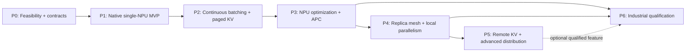
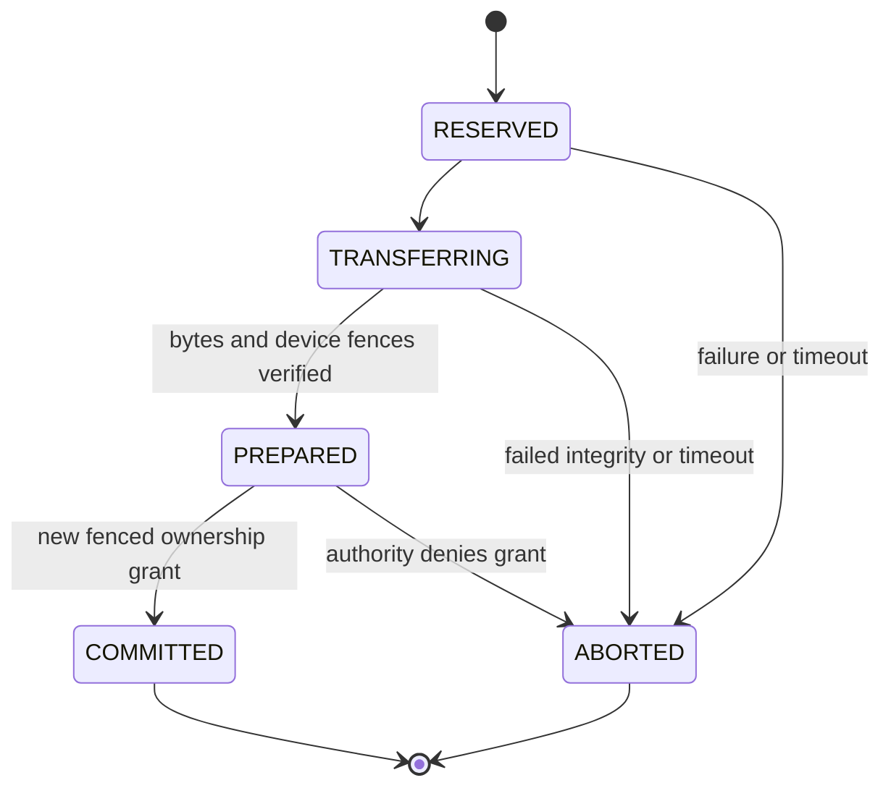

# LUMEN — Phased Implementation Roadmap

**Lightweight Unified Mesh Engine for NPU**  
Document ID: LUMEN-ROADMAP-001 | Version: 0.1 | Status: Proposed plan  
Date: 2026-11-25 | Companion: [Architecture Design Specification](LUMEN-Architecture-Design.md)

## Executive summary

Build LUMEN in vertical, measurable increments, not as a simultaneous implementation of every vLLM feature. The first MVP (minimum viable product) is a native C/C++ single-NPU inference service that loads one supported model, generates correct text, accepts multiple concurrent streaming requests and obeys bounded-memory rules. The CPU oracle and NPU feasibility work precede it. Continuous batching, paged KV, prefix reuse and NPU-specialized kernels turn the MVP into a throughput-oriented engine; distribution and industrial hardening follow behind explicit entry gates.

The roadmap is capability-driven: each phase produces a runnable service, a reproducible benchmark and a correctness report. A release does not advance because code is written; it advances because correctness, resource, performance and operational gates are met. The exact target NPU, memory, SDK, network and workload are not specified, so numeric thresholds and durations in this document are illustrative planning targets—not measured results, hard promises or universal performance requirements.

## 1. Target product and strategic sequencing

### 1.1 Minimum viable product versus final product

| Dimension | MVP (R0.1) | Industrial product (R1.0) |
|---|---|---|
| Runtime | Native C++ daemon, single device worker | Native library and daemon, isolated workers, replicated mesh |
| Model | One dense decoder-only GQA/MHA model | Qualified model/precision matrix; optional additional model families |
| Scheduling | Bounded queue and static or iteration batching | SLO-aware continuous batching, adaptive chunks, fairness, admission |
| KV | Fixed/contiguous baseline with logical page-compatible API | Native paged KV, APC, COW where applicable, optional swap |
| Device | One target NPU, known supported kernels/graphs | Capability-negotiated backend, tuned graph buckets, qualified precision |
| Network | HTTP/SSE, single node | Authenticated mesh, locality routing, qualified TP/PP, optional remote KV |
| Assurance | Reference parity, tests, basic profiling | Fuzz/property tests, performance regression, fault/partition testing, release gates |
| Operations | Basic CLI/config, readiness and clean shutdown | Upgrade/rollback, quotas, monitoring, restart and recovery, signed artifacts |

### 1.2 Architecture rules that must hold from day one

- No Python in the shipped runtime or mandatory model packer. Use C++20 and a C-compatible backend ABI. Vendor kernel toolchains may be used explicitly at build time; offline external reference generation is optional, not a runtime dependency.
- One logical owner of request state and KV decisions; workers receive immutable plans and return epoch-tagged completion results.
- Preallocate hot-path storage and bound every queue, page reservation, token buffer and in-flight transfer.
- Keep CPU reference and mock backends permanently; never make correctness tests require scarce NPU access.
- Every optimization must preserve token-accounting and KV invariants, provide measurable improvement on the target workload, and have a controlled fallback or feature gate.
- Ship only supported combinations, not a Cartesian product of unqualified features.

## 2. Roadmap overview



| Phase | Release | Planning effort* | Primary deliverable | Exit gate |
|---|---|---:|---|---|
| P0 | R0.0 | 2–4 weeks | Device qualification, CPU oracle, ABI skeleton | Correct reference path; NPU capabilities demonstrated |
| P1 | R0.1 | 4–6 weeks | Native single-NPU streaming MVP | Correct generation; bounded concurrent service |
| P2 | R0.2 | 5–7 weeks | Continuous batching and paged KV | Safety invariants; higher SLO goodput than R0.1 |
| P3 | R0.3 | 6–8 weeks | NPU-optimized inference and prefix reuse | Qualified kernels, accuracy, tail latency, thermal behavior |
| P4 | R0.5 | 5–8 weeks | Replica mesh, local TP if supported | Scale-out and rank/replica fault isolation |
| P5 | R0.7 | 6–10 weeks | Optional PP, remote KV, phase disaggregation | Transfer correctness and positive net workload benefit |
| P6 | R1.0 | 6–10 weeks | Industrial release qualification | All applicable acceptance gates passed |

*Indicative elapsed engineering windows with a small team and accessible NPU SDK; integration may overlap, and closed SDKs, custom kernel work or board procurement can extend them substantially. Fully sequential work sums to 34–53 weeks; an approximately 9–13 month program is a planning hypothesis, not a commitment. Security, CI, observability and reliability work starts in P0 and continues throughout. P5 is not a mandatory dependency for R1.0 if its features are not economically justified or hardware-qualified.*

## 3. P0 — Feasibility, hardware characterization and architecture contracts

**Objective:** eliminate the main hardware and correctness uncertainties before implementing a full engine.

### Work packages

| ID | Task | Output |
|---|---|---|
| P0.1 | Select one target NPU SKU, board, Linux/driver/SDK versions and build toolchain | Hardware qualification matrix and reproducible setup |
| P0.2 | Select a first small model (e.g., 0.5–3B dense GQA/MHA), tokenizer and precision | Immutable test fixture, license record and model traits |
| P0.3 | Implement minimal CMake project, native status types, checked math, TensorView, backend ABI | CPU and mock adapters, CI on ARM64/x86-64 where available |
| P0.4 | Build CPU FP32 reference for embeddings, RMSNorm, RoPE, attention, MLP, logits and greedy generation | Operator and layer golden vectors; independent reference comparison |
| P0.5 | Characterize NPU alloc/free, memory types, DMA, queue/event lifecycle, graph/kernel launch, synchronization | Timing distribution and memory profile |
| P0.6 | Test custom attention/paged gather support, graph shape constraints, GEMM precision and vendor collective access | Capability report with supported/unsupported features |
| P0.7 | Build minimal event-driven simulator with mock worker delays and KV capacity | Deterministic event traces and scheduling experiments |

### Device microbenchmark suite

- Host launch overhead, event polling latency, H2D/D2H and D2D bandwidth (small and large transfers), queue concurrency and real DMA/compute overlap.
- GEMM shape sweep for representative decode and prefill sizes; memory bandwidth; supported fused or quantized kernels; on-chip SRAM limits and alignment.
- Device memory available after driver initialization, workspace peaks, allocator behavior, error propagation and supported reset mechanism.
- Network and collective tests for intended interconnect (RTT distribution, effective throughput, small-message all-reduce latency, congestion and CPU cost) if multiple nodes are accessible.
- Cold versus warm performance, thermal saturation, competing memory traffic, sustained power.

### Exit criteria

1. CPU reference agrees with independently generated fixtures for the first model (operator-specific numeric tolerances set before testing); greedy output matches on non-ambiguous test cases.
2. Target NPU completes an actual supported kernel or graph with observed asynchronous completion semantics; results match CPU/reference within agreed tolerance.
3. Host and device memory ownership, device handle lifetime, queue and event contracts documented and tested; no unresolved fundamental feasibility issue for chosen MVP.
4. If custom paged attention is not available, record a constrained contiguous/gather fallback and a go/no-go condition for P2/P3. Do not claim native paging performance on a closed backend.

## 4. P1 — Native single-NPU MVP (R0.1)

**Objective:** deliver a complete user-facing generation service without Python in the serving path.

### Implementation sequence

1. Implement native model packer for the selected source format (Safetensors first, GGUF later if useful), weight/tensor validation, model manifest and graph selection. Start with one qualified precision.
2. Implement tokenizer and model-specific chat template with exact parity fixtures; integrate deterministic CPU sampler and incremental detokenization.
3. Build model runner and device backend using vendor kernels/graphs. Use a fixed-shape or bucketed model forward path, with preallocated contiguous KV and scratch. Keep `IKVStore` and step plan API independent of storage layout so P2 can replace the allocator.
4. Implement request state machine, fixed-size request pool, token slabs, bounded admission, immutable `StepPlan`, one in-flight iteration per sequence, event-based completion and safe cancel.
5. Add simple FCFS/static batching or iteration-level decode where supported; multiple active clients may queue without requiring sophisticated mixed prefill/decode yet.
6. Implement `lumend`, HTTP/SSE endpoint, native library API skeleton, streaming, readiness, health, logging, CLI and basic benchmark. Handle slow clients and disconnects with bounded output buffers.
7. Add cross-build, clean shutdown, model startup/warmup and reproducible integration tests.

### MVP contract

```text
Supported: one dense model, one NPU, greedy/temperature/top-k sampling,
           bounded concurrent clients, max context/output validation,
           streaming SSE, cancel, overload rejection, metrics.
Deferred: APC, native paged attention, cross-node TP/PP, remote KV,
          guided decoding, speculative decode, MoE, full API parity.
```

Initial experiment envelope (adjust after P0): 4 active sequences, 16 queued requests, 2K context, prompt/output sweeps with 128–512 token prompts and 64–256 generated tokens. A request over the configured limits is rejected predictably, not truncated silently. Use a larger context only if the model and memory support it.

### Exit criteria

- Complete a streamed request through HTTP and through the internal/native interface; multiple requests complete without cross-request state leakage. Run seeded tests with deterministic scheduling and greedy or qualified RNG semantics.
- Validate EOS, length stop, cancellation before/during device execution, invalid inputs, repeated startup/shutdown, and slow consumer handling.
- Run at least 1,000 mixed requests and a 2-hour stress test without crashes, invalid page/sequence references or monotonically growing LUMEN-owned allocations after warmup. Include realistic driver-reserved memory in a separate accounting category.
- Record baseline TTFT, ITL/TPOT, throughput, p99 host scheduling/dispatch cost, memory high water and energy where sensors permit. A latency target is not claimed until measured on target hardware.

## 5. P2 — Throughput engine: continuous batching and paged KV (R0.2)

**Objective:** change from a model-serving wrapper into an actual native high-throughput inference engine.

| Work package | Implementation and test |
|---|---|
| P2.1: KV allocator | Fixed page pool, generation-tagged handles, block tables, slot mapping, transactional reservations, reference/lease counts and free/evictable lists |
| P2.2: Attention interface | CPU paged attention oracle and NPU paged kernel/operator where available; bounded gather fallback when necessary |
| P2.3: Scheduler | Decode-first iteration batching, chunked prefill, token and sequence budgets, fair aging, strict admission and output credits |
| P2.4: Executor | Plan validation, per-step metadata staging, immutable snapshots, completion fence, stale epoch rejection, safe partial-launch failure handling |
| P2.5: Cost model | Empirical step latency tables, supported graph buckets, memory/scratch limits; discrete-event simulator calibration |
| P2.6: Instrumentation | Trace admission, scheduler decisions, plan size, device start/end, KV occupancy, queue pressure and output timestamps |

Start with a page size of 16 tokens, but make it part of the model/layout descriptor. Use logical block tables on host and a compact validated device table. Baseline is full-attention dense model only. Preserve one uncommitted step per sequence. Ensure chunked prefill does not emit tokens until the final prompt logits are available, and preserve distinction between sampled output and computed KV. Design page reuse to be impossible until all asynchronous readers/writers retire.

### Recommended algorithm development order

1. Randomized allocator and sequence-state tests with mock async completions.
2. CPU dense-to-paged attention equivalence across random block layouts, partial pages, context boundaries and causal masks.
3. NPU implementation of page addressing, append, and attention; differential tests against CPU.
4. Batch decode with multiple contexts; then incremental admission and removal at iteration boundaries.
5. Chunk prefill; test no output before final prompt chunk, no invalid context reads and no starvation under mixed traffic.
6. Time-budgeted scheduler; compare decode-first with simple FCFS and fixed chunk policy.

### Exit criteria

- At least 100,000 randomized allocator/state transitions with injected stale completion, cancel, failed reservation and partial launch; no invariant violation, double free or stale handle use.
- CPU/NPU attention outputs meet agreed per-dtype tolerance for tested shapes; no out-of-bounds or uninitialized KV accesses in supported cases.
- No OOM under the declared strict admission envelope; deliberate overload gives explicit rejection/defer rather than memory corruption or unlimited queue growth.
- Demonstrate improved SLO goodput relative to R0.1 on at least one representative mixed-load scenario, without unacceptable p99 ITL regression. Suggested initial goal: >=1.3x goodput at comparable SLO and model quality. This is a target, not a measured or universal requirement; if no gain, diagnose NPU gather/launch/padding costs before proceeding.
- Verify deterministic schedule replay with identical event streams and cost snapshots. Capture actual latency distributions, not only aggregate tokens/s.

## 6. P3 — NPU-native performance and prefix reuse (R0.3)

**Objective:** establish the hardware-specific competitive advantage and a mature single-node product.

### P3.1 Operator and graph optimization

Prioritize by profiling, not assumed GPU bottlenecks. Compare fused RMSNorm/residual, QKV projection + RoPE + KV write, SwiGLU/MLP and decode attention. Tune DMA bursts, SRAM tiling, on-chip reuse, double buffers and reduction patterns. Precompile graph variants and measure shape padding; avoid graph recompilation and LUMEN-owned heap allocation in the steady-state engine/device hot path. Measure vendor runtime allocations separately, since the engine may not control them.

Develop at least two attention paths: bandwidth-oriented single/few-token decode and compute-oriented prefill. For long context, split-KV reductions merge online-softmax state correctly. Evaluate page sizes 8/16/32/64; choose with actual device layout, tail waste, cache reuse and DMA behavior. Device sampling is desirable, but CPU fallback remains qualified where it is faster or required. Introduce low-bit weights one format at a time (e.g., hardware-native W8A8 or INT4 weight-only), then consider quantized KV. Each combination requires separate quality, memory and performance evidence.

### P3.2 Automatic prefix caching and memory policy

- Chained hash with exact model/layout/tokenization semantics, tenant scope, generation and collision verification; cache only sealed full blocks initially.
- Implement longest-prefix lookup, atomic pinning, cold unreferenced eviction, cache hit metrics, and all-prefix-hit handling with final token recomputation (KV alone does not yield logits).
- Implement and test COW when branching or partial-tail sharing is introduced; otherwise avoid unnecessary copies. Use fenced copies and transactional remap.
- Add optional preemption/recompute and host swap only after cost measurements. On unified-memory SoCs, verify that swap is a meaningful physical memory tier.
- Qualify strict vs elastic admission as distinct modes. Elastic mode may trade lower predictability for higher memory utilization; require clear overload behavior.

### P3.3 SLO-aware scheduler and advanced sampling

Use measured per-bucket duration estimates to adapt chunked prefill. Add service classes, fair admission, per-tenant quotas, thermal-aware caps, supported Top-P/Min-P/logprobs and repetition penalties. Guided decoding is optional and must use bounded state and resource limits. Introduce per-request counter-based RNG and deterministic replay qualification.

### Exit criteria

- Zero steady-state allocations in instrumented LUMEN-owned scheduler/allocator/runner paths after warmup (except explicitly bounded cold paths); no monotonic memory growth in 24-hour soak.
- APC hit and miss outputs match uncached reference under qualified numerical rules; test eviction, tenant isolation, model version changes and partial last page. Verify 100% lookup of a known compatible retained full prefix in a controlled warm-cache test; report actual reusable token count after final-token requirements.
- Quantization acceptance thresholds are signed off per model and task; example initial tolerance: <=1 percentage point drop on a selected representative accuracy task or <=2% relative perplexity increase, subject to task suitability and model owner approval.
- Demonstrate improved performance against R0.2 using identical requests/precision (or report precision change separately). Suggested goals: >=15% goodput improvement or >=20% device-step latency reduction for targeted shape workloads; show energy/thermal trade-off and no material quality regression.
- Run mixed short/long requests at the maximum declared supported context, load, temperature and memory envelope. Publish p50/p95/p99/p99.9 latency and capacity curve.

## 7. P4 — Distributed serving: local parallelism and Edge Mesh (R0.5)

**Objective:** scale service capacity across devices and edge nodes without imposing data-center communication assumptions.

### P4A: Replica mesh (implement first)

- Static registry, authenticated node advert, model version and readiness reporting, bounded router queues and request-level routing.
- Weighted routing using queue time, local load, KV headroom, locality, model compatibility and optional prefix affinity. Use hysteresis and TTL for stale metrics.
- Idempotency for request submission, request-level timeout, retry before first token only by default, no duplicated emitted outputs. Local engine remains sole sequence owner.
- Failure detection, node draining, rolling deployment, overload reroute and observability. Test multiple independent instances on one host before deploying separate edge devices.

### P4B: Local TP (only when qualified)

- Implement offline rank sharding of attention/MLP/embedding/LM-head weights according to explicit partition descriptors.
- Use supported collectives with sequence ordering, rank/group epoch and bounded timeout. Implement consistent logical block reservations across ranks and rank-local KV layout mapping.
- Verify logits parity against single-rank reference at small model size. Then demonstrate a larger model that requires the TP group or show a latency/goodput benefit on the same model.
- Profile collective latency, bandwidth, compute/communication overlap and host CPU cost. Prefer vendor device collectives (e.g., HCCL on supported Ascend systems) or validated transport; do not assume CUDA/NCCL.
- Inject rank loss during each collective/launch stage; fence group and fail affected requests without contaminating other replicas.

### Exit criteria

- With two equal, independent replicas and an adequately provisioned router/network, suggested target >=1.7x aggregate SLO goodput of one replica on a balanced workload; include routing overhead and skew tests. Failure reroute must not duplicate streamed tokens.
- TP correctness: supported rank counts and model shapes match reference tolerances; group commits atomically at each iteration; failure timeout and recovery are bounded and observable.
- TP is enabled only if memory feasibility or measured SLO performance justifies it. A slower but necessary TP configuration for a larger model may be supported if it meets declared SLOs; otherwise keep the feature disabled.
- Measure actual network path and identify where local TP ceases to be economical. Do not qualify WAN or inter-site TP by extrapolation from local links.

## 8. P5 — Advanced distribution and remote KV (R0.7, optional)

**Objective:** exploit aggregate edge memory/compute for valuable workloads, with explicit ownership and cost-based deployment.

### Feature prioritization

| Feature | Entry criterion | Implementation |
|---|---|---|
| PP | Model cannot fit locally, TP communication too costly, acceptable per-token latency | Layer-stage partition, bounded activation buffers, microbatch scheduling, stage fence |
| Remote KV | Reuse/restore saves more time than transfer, compatible layout and adequate network | Transfer manifest, pinned source snapshot, reserve target, checksums, credits, fenced commit |
| Prefill/decode separation | Sustained asymmetric workloads or complementary NPU resources, measured positive SLO goodput | Role-aware router, transfer protocol, admission coupling, backpressure |
| Global prefix hints | Meaningful repeat-prefix rate across nodes | Bounded metadata directory with TTL, no direct shared mutable pages |
| Speculative decoding | Available draft model or mechanism with demonstrated acceptance and net savings | Exact acceptance algorithm where required, rollback-safe KV, separate token accounting |
| MoE/EP, MLA, multimodal | Product requirement and explicit device/model support | Separate model capability and KV layout extensions; not default R1.0 obligations |

### Remote ownership state machine



Implement authoritative ownership epochs, idempotent transfer IDs, immutable source KV snapshots, checksum and compatibility validation, bounded staging memory, per-transfer timeouts and cleanup. Source cannot generate once ownership is handed off; target cannot generate before grant. Network partition and delayed acknowledgements must not lead to split-brain. If fencing authority is unavailable, fail closed. Resume only from a committed token/RNG/output-offset checkpoint. No silent regeneration of already emitted tokens.

### Go/no-go performance test

Estimate and measure total transfer time including source/target copy, packet overhead, encryption, verification, congestion and admission. An illustrative conventional GQA model with 128 KiB KV/token needs 1 GiB at 8K context; ideal transfer at 50 Gb/s is about 172 ms before overhead. Compare against recomputation, local queue wait and remaining SLO; test with short/long prompt mixes, repeated prefixes, burst arrivals and degraded links. Establish a policy threshold where a transfer is actually useful, rather than enabling remote KV globally.

### Exit criteria

- Fault injection covers duplicate chunks, stale epochs, lost ACKs, partial transfers, corrupt payload, source failure, target failure and network partition. No simultaneous valid ownership grant and no leaked reservations.
- Handoff produces correct subsequent tokens on compatible target backend within agreed numerical rules; any conversion requires separate tests. No duplicate emitted token offsets.
- PP/P-D/remote KV each requires a workload-specific positive benefit (capacity feasibility, lower p99 latency, lower energy, or higher SLO goodput), with no hidden regression outside the feature's declared envelope.
- Disable unqualified paths in production. A successful industrial R1.0 can consist of P3 single-node and P4 replica mesh without P5; advanced distribution is not a checklist obligation.

## 9. P6 — Industrial product qualification (R1.0)

**Objective:** make a bounded, supportable and secure product that can be deployed continuously on network-edge appliances.

### Qualification workstreams

| Workstream | Required delivery |
|---|---|
| Reliability | Health state machine, watchdog, worker restart/reset, group fencing, graceful drain, crash reason classification, bounded recovery |
| Security | Authentication/TLS, tenant quotas, request/model parsing fuzz tests, signed artifacts, least privilege, SBOM, dependency/license and vulnerability review |
| Operations | Versioned configuration, startup self-test, readiness, logs/metrics/tracing, model and binary rollback, support diagnostics |
| Portability | Reproducible ARM64/x86-64 builds where supported, target SDK compatibility matrix, explicit device capability reporting |
| Performance | Load/capacity curves, SLO goodput, long-context and burst tests, thermal/power and shared-resource interference qualification |
| Quality | Independent semantic fixtures, randomized lifecycle tests, backend matrix, ABI compatibility tests, deterministic replay |
| Product | Installation/runbooks, API contract, known limits, supported model/precision matrix, incident and escalation procedures |

### Release acceptance gates

| Area | Proposed R1.0 gate | Measurement |
|---|---|---|
| Correctness | All required model/operator fixtures pass; no known critical KV/sequence consistency bug | Independent oracle and differential tests; qualified numeric tolerances |
| Memory safety | No critical sanitizer finding or reproducible UAF/double-free/OOB; no OOM inside declared strict envelope | ASan/UBSan/TSan as appropriate, fuzz and fault injection, allocator invariants |
| Stability | 72-hour target-board soak with zero unexpected crash/hang or unbounded LUMEN memory growth | Open-loop mixed traffic, cancellation, thermal cycles; monitor driver separately |
| Host overhead | Candidate goal p99 scheduler + KV planning + dispatch CPU time <=5% of representative device-step duration | Instrumented trace; report absolute microseconds, batch and shape; revise with evidence |
| SLO | Example interactive class p99 TTFT <=500 ms, p99 ITL <=80 ms for a named qualified prompt/output/load profile | Client-observed monotonic timing; profile specific, not universal |
| Goodput | At least 99% of admitted requests meet declared request SLO under nominal qualified load; report rejected demand and offered load | Define TTFT and ITL criteria per request; count failures/timeouts as misses; plot saturation |
| Memory footprint | Initial target <=64 MiB engine-owned host metadata/scratch (excluding tokenizer, weights, vendor runtime, OS and configured token/output/KV staging pools); report full RSS/PSS too | Per-category allocation telemetry and process memory accounting |
| Recovery | Example target healthy replica routing restored <=10 s after detectable node loss; local worker readiness recovery budget measured separately | Repeated injected crashes, partitions and driver resets |
| Security | No unresolved release-blocking vulnerabilities; model and config integrity verified | Threat model, fuzz/security tests, signed artifact verification |
| Deployment | Reproducible clean install, upgrade, drain, rollback and reinstall on supported device images | Automated deployment acceptance suite |

All targets above are provisional until P0/P1 measurement and product agreement. Define SLO percentiles over a declared observation window and population, including rejection rate, output lengths and cache hit profile. Goodput excludes requests that fail the SLO; report offered/admitted/completed rates separately so aggressive rejection cannot hide poor capacity. A 72-hour soak is evidence, not proof of zero production failures. Hard real-time certification is outside R1.0 unless a separate qualified platform program is initiated.

## 10. Recommended repository structure and build deliverables

```text
LUMEN/
  CMakeLists.txt
  cmake/toolchains/              # arm64, x86_64, target NPU SDK
  include/lumen/                # public C ABI and client headers
  src/
    frontend/                   # HTTP/SSE and reactor
    tokenizer/                  # model tokenizer, chat template
    engine/                     # lifecycle, StepPlan, completion
    scheduler/                  # pure scheduling policy and costs
    memory/                     # arena, block pool, APC, transfer leases
    executor/                   # rank group and dispatch
    model/                      # manifest, TensorView, model runners
    backend/{cpu,mock,target_npu}/
    kernels/{reference,target_npu}/
    collective/                 # local group communication
    mesh/                       # routing, node registry, handoff protocol
    observability/              # metrics and replay trace
  tools/{pack,bench,replay,inspect}/
  sim/                          # discrete-event simulator and cost models
  tests/{unit,property,oracle,integration,fault,perf}/
  fixtures/                     # small licensed models and golden tensors
  configs/{dev,edge,mesh}/
  deploy/{systemd,container}/
  docs/{architecture,adr,api,runbooks}/
```

Artifacts: `liblumen` (optional public library), `lumend` service, `lumen-pack` offline model converter, `lumen-bench` open-loop load generator and microbenchmark, `lumen-replay` trace/simulator tool, `lumen-inspect` model/backend capabilities inspector. Use CMake presets and a dependency lock/manifest. Native tests should run on development machines without the NPU SDK; device CI jobs run on qualified boards. Keep third-party dependencies minimal but do not reimplement mature HTTP/TLS/tokenizer/format libraries merely to avoid dependencies. Audit licenses, transitive footprint and runtime behavior.

## 11. Benchmark and simulation methodology

### 11.1 Workload matrix

| Dimension | Initial sweep (within qualified memory/model limits) |
|---|---|
| Model | Small 0.5–3B first, then representative ~7B if supported; same checkpoints across comparisons |
| Prompt | 128, 512, 2K, 8K tokens; long-context extension only when qualified |
| Output | 32, 128, 512 tokens; fixed output-length mode and realistic EOS mode both reported |
| Active sequences | 1, 2, 4, 8, 16, then capacity sweep |
| Arrivals | Closed-loop microbench, open-loop Poisson, bursty and anonymized trace-driven |
| Prefix reuse | Cold cache, controlled shared prefix, mixed hit/miss, tenant-separated |
| Precision | BF16/FP16 baseline, supported INT8/INT4; KV quantization separate |
| Device | Cold/warm, sustained thermal load, background memory/NIC contention |
| Network | Local, qualified edge links, bandwidth/RTT/jitter/loss sweep |
| Fault | Cancel, slow client, worker crash, rank loss, transfer corruption, partition |

Collect raw timestamps and resource counters. Use fixed seeds, versioned model/SDK/kernel/config digests, explicit warmup, repeated trials and confidence intervals where useful. Compare CPU reference for correctness, vendor-native inference for device ceiling, llama.cpp or vLLM on the same hardware if a comparable supported backend exists, and LUMEN's own prior release for attribution. Never compare a native NPU engine to an unrelated GPU result and claim an implementation speedup. Record when an external baseline cannot be run fairly.

### 11.2 Simulation and performance model

Implement a C++ discrete-event model with ingress/tokenizer events, sequence lifecycle, batch scheduling, logical KV pages, cache hit/miss, worker queue, shape-specific measured durations, DMA/collectives and network transfers. Reuse pure scheduling policy and model descriptors where practical, but keep an independent correctness oracle to avoid shared bugs. Feed measured device tables and trace distributions into the simulator. Validate predicted p50/p99 latency, memory occupancy and goodput against held-out real runs; initial calibration goal <=15% relative error for p50 and <=25% for p99 in a qualified range. Report error near saturation and outside measured ranges rather than silently extrapolating. Use the simulator to compare chunk sizes, watermarks, fairness, replica routing, P/D placement and migration policies before expensive device experiments.

### 11.3 Release report template

```text
release / commit / build flags / hardware / SDK / model digest
precision / KV layout / graph buckets / scheduler / memory limits
workload / arrival distribution / seed / warmup / test duration
quality: operator errors, token parity, task metrics
latency: TTFT p50/p95/p99; ITL p50/p95/p99/p99.9; TPOT; E2E
capacity: offered/admitted/completed/rejected; prompt/decode TPS; SLO goodput
resources: host RSS/PSS, KV/weights/workspace bytes, CPU/NPU usage, power/temp
failure: count, category, recovery duration, invariant violations
comparison: matched baseline, deltas, limitations, raw trace link
```

## 12. Engineering organization and delivery discipline

A suggested team is 6–9 engineers (not a staffing requirement): 1 architecture/engine lead, 1–2 runtime/scheduler developers, 2 NPU kernel/backend specialists, 1 model/quantization engineer, 1 distributed/transport engineer and 1–2 verification/performance/operations engineers. Roles may overlap; device SDK access and kernel expertise are likely critical-path resources.

| Track | P0–P1 | P2–P3 | P4–P6 |
|---|---|---|---|
| Engine | Lifecycle, ABI, MVP | Scheduling, KV, APC | Distributed lifecycle and SLO hardening |
| NPU | Capability probes, reference forward | Paged kernels, graph/quant optimization | Collectives, backend qualification |
| Model | Packer, tokenizer, one model | Precision and layout qualification | Sharding and supported model matrix |
| Mesh | Network characterization | Simulator and interface design | Replica routing, TP, optional remote KV/PP |
| Quality/Ops | CI, oracle, metrics | Property tests, load, soak | Fault/partition tests, security, release gates |

Keep architecture decision records (ADRs) for backend ABI, state ownership, KV layout, page size, scheduler policy, distributed authority, model format and precision. Every performance PR should include benchmark evidence or state why not applicable; every change to KV/lifecycle needs invariant and fault tests. Require code review for resource ownership, checked arithmetic, async fences and versioning. Use feature flags with safe defaults; no runtime experiment silently changes a production model's precision or cache semantics.

## 13. Risk register and decisions

| Risk | Impact | Mitigation / decision gate |
|---|---|---|
| Closed NPU SDK cannot support paged attention | High | P0 feasibility probe; bounded gather fallback; secure vendor support or limit product scope |
| Driver graph launch overhead dominates small batches | High | Measure launch/event cost early; graph buckets, fusion and command reuse |
| Low-bit GEMM unsupported or inaccurate | High | Qualify one native precision; explicit fallback and task-level quality gate |
| Dynamic shapes cause padding/variant explosion | Medium–high | Finite measured buckets; masks and bounded workspace; reject unsupported shapes |
| Async page reclamation race | Critical | Generation handles, leases, fenced transactions, randomized tests, single writer |
| Shared host/device DRAM contention and thermal throttle | High | Sustained profiling, bandwidth model, caps and admission feedback |
| Cross-edge communication dominates decode | High | Replica-first, PP/TP conditional, measured transfer decision and locality routing |
| Split-brain during remote handoff | Critical | Authoritative fencing epochs, fail closed, partition testing |
| API/model family expansion delays core engine | High | One model first, feature capability matrix and non-goals |
| Native dependency/SDK drift | Medium–high | Versioned ABI, reproducible builds, compatibility tests and signed artifacts |
| No fair external performance baseline | Medium | Own release baseline + vendor kernels, disclose comparison limits |

## 14. First engineering backlog (first four weeks)

| Priority | Issue | Acceptance artifact |
|---|---|---|
| P0 | LUMEN-001: Build skeleton and C ABI | CI builds native CPU/mock; ABI version and status codes |
| P0 | LUMEN-002: NPU qualification harness | JSON/CSV timing, memory and capability report |
| P0 | LUMEN-003: Model fixture and native tensor loader | Bounds-checked parser tests, immutable fixture and manifest |
| P0 | LUMEN-004: CPU reference Transformer | Layer/logit comparisons and greedy generation golden test |
| P0 | LUMEN-005: Engine state/StepPlan contract | State transition tests and cancellation/epoch tests |
| P0 | LUMEN-006: Mock async executor and replay | Injected completions, reproducible trace |
| P1 | LUMEN-007: NPU forward integration | First layer and full small-model logits correct |
| P1 | LUMEN-008: Bounded native frontend | HTTP/SSE smoke tests, queue overload and disconnect |
| P1 | LUMEN-009: KV page allocator model | Property test skeleton, generation and lease invariants |
| P1 | LUMEN-010: Benchmark harness | First matched single-request and concurrency baseline |

The first demo milestone is intentionally simple: load one small model on the actual NPU, stream correct generated tokens from a native process, inspect device/host timings, cancel a request safely and reproduce the result from a test script. Do not begin a distributed KV implementation before this milestone.

## 15. Reference implementations and research

- Orca, iteration-level scheduling: https://www.usenix.org/conference/osdi22/presentation/yu
- vLLM, PagedAttention: https://arxiv.org/abs/2309.06180
- vLLM, APC design: https://docs.vllm.ai/en/stable/design/prefix_caching/
- Sarathi-Serve, chunked prefill: https://arxiv.org/abs/2403.02310
- FlashAttention, IO-aware exact attention: https://arxiv.org/abs/2205.14135
- DistServe, prefill/decode disaggregation: https://arxiv.org/abs/2401.09670
- llama.cpp, native C/C++ inference reference: https://github.com/ggml-org/llama.cpp
- vLLM Ascend, NPU disaggregated-prefill example: https://docs.vllm.ai/projects/ascend/en/latest/developer_guide/Design_Documents/disaggregated_prefill.html
- Safetensors and GGUF model formats: https://github.com/safetensors/safetensors ; https://github.com/ggml-org/ggml/blob/master/docs/gguf.md

---
End of LUMEN-ROADMAP-001. Review the hardware qualification and workload assumptions before approving the release schedule. The roadmap is intentionally designed to permit a production single-node/replica-mesh release without optional advanced distribution features.
